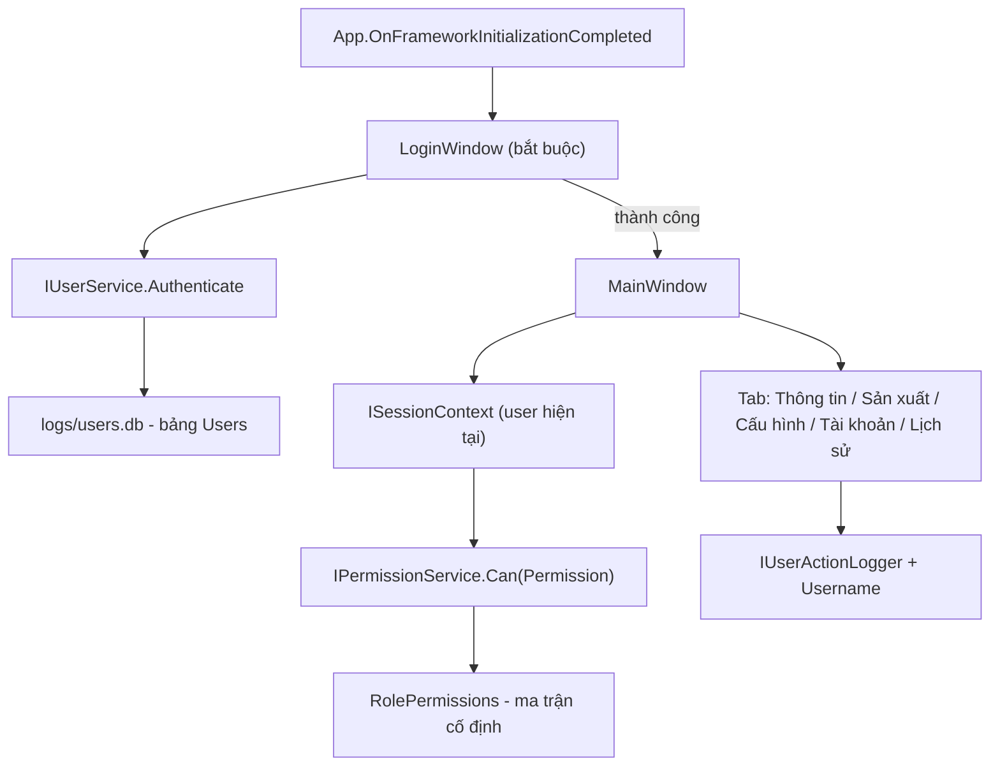

# Kế hoạch: Quản lý tài khoản, đăng nhập/đăng xuất, phân quyền

## Quyết định đã chốt
- Lib mới `ClassLibraryMT.Auth` (độc lập, dùng chung cho app khác sau này).
- CSDL riêng `logs/users.db` (không dùng chung `app.db`).
- Bắt buộc đăng nhập trước khi vào app (màn hình Login riêng).
- Giao diện quản lý tài khoản: tab "Tài khoản" riêng, chỉ Administrator thấy.
- Tài khoản admin đầu tiên được seed sẵn (`admin`/`admin`) khi lần đầu chạy; bắt buộc đổi mật khẩu ở lần đăng nhập đầu tiên.
- Ma trận quyền cố định trong code (`enum Permission` + switch theo Role).
- Nhật ký thao tác ghi vào bảng `UserActions` sẵn có, bổ sung cột `Username`/`UserId`.
- Phiên đăng nhập không duy trì sau khi đóng app (đóng app = đăng xuất).

## Kiến trúc tổng thể



## Phần 1: Lib `ClassLibraryMT.Auth`

Tạo project mới `ClassLibraryMT.Auth/ClassLibraryMT.Auth.csproj` (`net10.0`, `Nullable=enable`, `IsAotCompatible=true`, `GenerateDocumentationFile=true`, thêm vào [VisionF.slnx](VisionF.slnx)). Package: `Microsoft.Data.Sqlite` (tương tự lib Logging).

### Model & enum

`ClassLibraryMT.Auth/AuthModels.cs`:
```csharp
public enum UserRole { Worker = 0, Operator = 1, Administrator = 2, Developer = 3 }
```
- Dùng `int` làm giá trị lưu DB (sửa enum sau này không phá dữ liệu).
- `UserRoleNames` static class: map enum -> tên hiển thị tiếng Việt ("Nhân viên", "Vận hành", "Quản trị", "Lập trình viên") + helper `Parse`/`ToDisplay`.

`ClassLibraryMT.Auth/Permissions.cs` — ma trận quyền cố định:
```csharp
[Flags]
public enum Permission
{
    None = 0,
    ViewProduction = 1 << 0,
    ViewInfo = 1 << 1,
    EditConfig = 1 << 2,
    ManageLicense = 1 << 3,
    ViewHistory = 1 << 4,
    ManageUsers = 1 << 5,
    ExportData = 1 << 6,
}
```
Ma trận (dùng `switch` trả về `Permission` cho từng role):
- **Worker**: `ViewInfo | ViewProduction`
- **Operator**: `ViewInfo | ViewProduction | EditConfig | ManageLicense | ExportData`
- **Administrator**: tất cả, gồm `ManageUsers`
- **Developer**: tất cả (như Administrator) — kể cả `ManageUsers`

`ClassLibraryMT.Auth/RolePermissions.cs`:
```csharp
public static class RolePermissions
{
    public static Permission For(UserRole role) => role switch { ... };
    public static bool Can(UserRole role, Permission p) => (For(role) & p) == p;
}
```

### Bảng DB (`logs/users.db`)

`ClassLibraryMT.Auth/AuthStore.cs` — quản lý connection + schema, giống pattern `SqliteLogWriter` (WAL, `busy_timeout`, `CREATE TABLE IF NOT EXISTS`):

| Bảng | Cột |
|---|---|
| `Users` | `Id INTEGER PK AUTOINCREMENT`, `Username TEXT NOT NULL UNIQUE`, `DisplayName TEXT`, `PasswordHash TEXT NOT NULL`, `PasswordSalt TEXT NOT NULL`, `Role INTEGER NOT NULL`, `IsActive INTEGER NOT NULL DEFAULT 1`, `MustChangePassword INTEGER NOT NULL DEFAULT 0`, `FailedAttempts INTEGER NOT NULL DEFAULT 0`, `LockedUntilUtc TEXT NULL`, `LastLoginUtc TEXT NULL`, `CreatedUtc TEXT NOT NULL`, `UpdatedUtc TEXT NOT NULL` |
| `SchemaVersion` | `Version INTEGER PK`, `AppliedUtc TEXT` |

Index: `IX_Users_Username` (đã có UNIQUE), `IX_Users_Role`.

### Hash mật khẩu

`ClassLibraryMT.Auth/PasswordHasher.cs`:
- Dùng `Rfc2898DeriveBytes.Pbkdf2(password, salt, iterations: 210_000, hashAlgorithm: SHA256, outputLength: 32)` — .NET 10 hỗ trợ sẵn, không cần package.
- Lưu format: `PBKDF2-SHA256$210000$<base64 salt>$<base64 hash>`.
- `Verify(password, stored)` dùng `CryptographicOperations.FixedTimeEquals`.
- Constant-time compare để tránh timing attack.

### Service & DI

`ClassLibraryMT.Auth/IUserService.cs`:
```csharp
public interface IUserService
{
    Task<AuthResult> AuthenticateAsync(string username, string password, CancellationToken ct = default);
    Task<IReadOnlyList<UserAccount>> GetAllAsync(CancellationToken ct = default);
    Task<UserAccount?> GetByIdAsync(long id, CancellationToken ct = default);
    Task<UserAccount?> GetByUsernameAsync(string username, CancellationToken ct = default);
    Task<Result> CreateAsync(string username, string displayName, string password, UserRole role, CancellationToken ct = default);
    Task<Result> UpdateAsync(long id, string? displayName, UserRole? role, bool? isActive, CancellationToken ct = default);
    Task<Result> ResetPasswordAsync(long id, string newPassword, CancellationToken ct = default);
    Task<Result> SetPasswordAsync(long id, string currentPassword, string newPassword, CancellationToken ct = default);
    Task<Result> DeleteAsync(long id, CancellationToken ct = default);
    Task<Result> EnsureSeedAdminAsync(CancellationToken ct = default);
}
```
- `Result` record: `(bool Ok, string Message)`. `AuthResult`: `(bool Ok, string Message, UserAccount? User)`.
- Khoá tài khoản: sau 5 lần sai mật khẩu liên tiếp -> `LockedUntilUtc = now + 5 phút`.

`ClassLibraryMT.Auth/AuthModels.cs` bổ sung:
```csharp
public sealed class UserAccount
{
    public long Id { get; set; }
    public string Username { get; set; } = string.Empty;
    public string DisplayName { get; set; } = string.Empty;
    public string Role { get; set; } = string.Empty;   // tên role
    public UserRole RoleValue { get; set; }
    public bool IsActive { get; set; }
    public bool MustChangePassword { get; set; }
    public bool IsLocked { get; set; }
    public DateTime? LastLoginUtc { get; set; }
    public DateTime CreatedUtc { get; set; }
}
```

`ClassLibraryMT.Auth/ISessionContext.cs`:
```csharp
public interface ISessionContext
{
    UserAccount? CurrentUser { get; }
    bool IsAuthenticated { get; }
    UserRole CurrentRole { get; }
    void SignIn(UserAccount user);
    void SignOut();
    bool Can(Permission permission);
    event EventHandler? Changed;
}
```
- `SessionContext` là singleton trong DI, cài đặt ở app layer (lib chỉ cung cấp interface + model).

`ClassLibraryMT.Auth/AuthOptions.cs`:
```csharp
public sealed class AuthOptions
{
    public string DbPath { get; set; } = "logs/users.db";
    public int MaxFailedAttempts { get; set; } = 5;
    public int LockoutMinutes { get; set; } = 5;
    public int Pbkdf2Iterations { get; set; } = 210_000;
    public string SeedAdminUser { get; set; } = "admin";
    public string SeedAdminPassword { get; set; } = "admin";
}
```

`ClassLibraryMT.Auth/AuthServiceCollectionExtensions.cs` — `services.AddAuth(configuration)`:
- Bind `AuthOptions` thủ công bằng `ConfigReader.GetString/GetInt` (pattern AOT-safe sẵn có ở [ClassLibraryMT/Configuration/ConfigReader.cs](ClassLibraryMT/Configuration/ConfigReader.cs)).
- Đăng ký `IUserService` -> `UserService` (singleton), `ISessionContext` -> `SessionContext` (singleton).

## Phần 2: Ghi tài khoản vào nhật ký thao tác

Mở rộng bảng `UserActions` trong [ClassLibraryMT.Logging/LogModels.cs](ClassLibraryMT.Logging/LogModels.cs):
- Thêm `Username` (string) và `UserId` (long?) vào `UserActionEntry`.
- `SqliteLogWriter` tạo bảng: thêm cột `Username TEXT NOT NULL DEFAULT ''`, `UserId INTEGER NULL` + migration `ALTER TABLE` nếu bảng cũ đã tồn tại (dùng `PRAGMA table_info` để kiểm tra trước khi ALTER).
- `IUserActionLogger.Log(...)` giữ nguyên chữ ký; `UserActionLogger` tự đọc `ISessionContext` (optional dependency) để ghi `Username`/`UserId` khi có người dùng đăng nhập. Cách này không phá call-site hiện tại.

Vì `UserActionLogger` nằm trong lib Logging còn `ISessionContext` nằm ở lib Auth, dùng cách sau để tránh phụ thuộc vòng:
- `SqliteLogWriter` nhận `Func<UserAccount?>`? Không đẹp.
- **Cách chọn**: đặt interface `IUserContext` (chỉ có `string? Username`, `long? UserId`) trong **lib Logging**, và lib Auth cài đặt nó. `SqliteLogWriter` phụ thuộc `IUserContext?` (nullable, qua `IServiceProvider.GetService`). Như vậy lib Logging không cần biết lib Auth.

`ClassLibraryMT.Logging/IUserContext.cs` (mới):
```csharp
public interface IUserContext
{
    string? Username { get; }
    long? UserId { get; }
}
```
- Lib Auth: `SessionContext` implements cả `ISessionContext` và `IUserContext`.
- `UserActionLogger` inject `IUserContext?` (qua constructor với `IServiceProvider.GetService<IUserContext>()` trong `AddSqliteLogging`, hoặc đơn giản hơn: `UserActionLogger` nhận `IUserContext?` nullable constructor param — DI của MS.Extensions hỗ trợ nullable param? Không tự động. Dùng `IServiceProvider` và `GetService<IUserContext>()` trong constructor.)

## Phần 3: Màn hình đăng nhập

### `TanTienQR/Views/LoginWindow.axaml` + `.axaml.cs`
- Cửa sổ riêng, `WindowDecorations="None"` đồng bộ với custom chrome của `MainWindow` (copy phần header/logo/style).
- Layout: logo "TT", tiêu đề "Đăng nhập", 2 ô nhập (Username, Password - `PasswordChar` = `•`), nút "Đăng nhập", thông báo lỗi.
- Thêm checkbox "Ghi nhớ đăng nhập"? Không - quyết định đã chốt là không duy trì phiên. Bỏ qua.
- Hiển thị cảnh báo "Tài khoản mặc định admin/admin - hãy đổi mật khẩu" nếu đăng nhập bằng tài khoản seed.
- Xử lý `Enter` để submit: `KeyDown` handler trên Window.

### `TanTienQR/ViewModels/LoginViewModel.cs`
- `Username`, `Password`, `ErrorMessage`, `IsBusy`.
- `[RelayCommand] private async Task LoginAsync()`:
  1. Validate input rỗng -> error.
  2. `await _userService.AuthenticateAsync(...)`.
  3. Nếu `Ok` -> `_session.SignIn(user)`, log `Auth.Login` (Success/Failed), signal cho App đóng cửa sổ login.
  4. Nếu `user.MustChangePassword` -> mở hộp thoại đổi mật khẩu (PasswordChangeWindow) rồi mới vào app.
- `[RelayCommand] private void Cancel()` -> đóng app (đăng nhập bắt buộc).

### `TanTienQR/Views/PasswordChangeWindow.axaml` + `.axaml.cs`
- Hộp thoại modal nhỏ: mật khẩu mới + xác nhận, validate khớp + tối thiểu 6 ký tự.
- Gọi `IUserService.SetPasswordAsync(id, currentPassword, newPassword)`.

### `TanTienQR/App.axaml.cs` — luồng khởi động
```csharp
// 1. Build host, AddTanTienServices (gồm AddAuth)
// 2. EnsureSeedAdminAsync()
// 3. Hiện LoginWindow, chờ đóng
// 4. Nếu đăng nhập thành công -> tạo MainWindow
```
- `desktop.MainWindow` chỉ được gán SAU khi login thành công. Dùng `desktop.MainWindow = loginWindow` trước, rồi khi login OK -> `loginWindow.Close()` và tạo `MainWindow` mới.
- Với Avalonia, cách sạch: hiện `LoginWindow` không gán làm MainWindow; dùng `loginWindow.ShowDialog()` rồi `await` -> nếu kết quả OK thì tạo MainWindow và gán `desktop.MainWindow`.
- `ShutdownMode` mặc định `OnLastWindowClose` -> phải chuyển sang `OnExplicitShutdown` trong lúc mở login, rồi `OnLastWindowClose` sau khi vào app (để đóng login không kill app).

## Phần 4: Phân quyền trên UI

### Ẩn/hiện theo quyền
- `MainViewModel` thêm:
  - `IsConfigVisible` (tab Cấu hình) -> `Can(Permission.EditConfig)`
  - `IsHistoryVisible` -> `Can(Permission.ViewHistory)`
  - `IsUsersVisible` (tab Tài khoản) -> `Can(Permission.ManageUsers)`
  - `IsProductionVisible` -> `Can(Permission.ViewProduction)`
- Hiện tại `AppSection` + `IsXxxVisible` được quản lý ở [TanTienQR/ViewModels/MainViewModel.Tabs.cs](TanTienQR/ViewModels/MainViewModel.Tabs.cs) qua `CurrentSection`. Cần tách: giữ `CurrentSection` nhưng thêm điều kiện quyền:
  

```csharp
  public bool IsConfigVisible => CurrentSection == AppSection.Configuration && CanEditConfig;
  

```
- `MainViewModel` implement `INotifyPropertyChanged` đã có sẵn qua `[ObservableProperty]`. Cần gọi `OnPropertyChanged` lại khi session đổi -> subscribe `ISessionContext.Changed`.

### [TanTienQR/Models/AppSection.cs](TanTienQR/Models/AppSection.cs)
- Thêm `Accounts = 4` (và giữ `History = 3`).

### Header tab trong [TanTienQR/Views/MainWindow.axaml](TanTienQR/Views/MainWindow.axaml)
- Thêm segtab "Tài khoản" (icon user), `IsVisible="{Binding IsUsersTabVisible}"`.
- Sidebar: thêm nút "Tài khoản" trong nhóm "NHÀ PHÁT TRIỂN" hoặc nhóm mới "QUẢN TRỊ", `IsVisible="{Binding IsUsersVisible}"`.
- Nội dung: `<views:AccountsView IsVisible="{Binding IsUsersVisible}" />`.

### Đăng xuất
- Nút "Đăng xuất" ở sidebar hoặc trong header (cạnh nút "?"). Khi bấm:
  1. Log `Auth.Logout`.
  2. `_session.SignOut()`.
  3. Đóng MainWindow, quay lại LoginWindow (không tắt app).
- Implement trong `MainViewModel`: `[RelayCommand] private async Task LogoutAsync()`.

### Hiển thị user hiện tại
- Sidebar hoặc header: tên đăng nhập + role (badge màu theo vai trò).
- `MainViewModel`: `CurrentUserName`, `CurrentRoleText` bind từ `ISessionContext`.

## Phần 5: Tab quản lý tài khoản

### `TanTienQR/ViewModels/AccountsViewModel.cs`
- Load danh sách user (`GetAllAsync`), bind vào `ItemsControl`.
- Lệnh: `AddUserCommand`, `EditUserCommand`, `ResetPasswordCommand`, `ToggleActiveCommand`, `DeleteUserCommand`.
- Chặn tự xoá/khoá tài khoản đang đăng nhập.

### `TanTienQR/Views/AccountsView.axaml`
- Bảng: Username, Tên hiển thị, Vai trò (ComboBox), Trạng thái (badge), Lần đăng nhập cuối, nút thao tác.
- Nút "+ Tài khoản" mở hộp thoại tạo/sửa.
- Badge màu theo vai trò: Worker=xám, Operator=xanh dương, Administrator=teal, Developer=tím.

### `TanTienQR/Views/UserEditWindow.axaml`
- Form: Username (chỉ khi tạo), Tên hiển thị, Mật khẩu, Xác nhận mật khẩu, Vai trò (ComboBox).

## Phần 6: Cấu hình

[TanTienQR/appsettings.json](TanTienQR/appsettings.json) - thêm section:
```json
"Auth": {
  "DbPath": "logs/users.db",
  "MaxFailedAttempts": 5,
  "LockoutMinutes": 5,
  "Pbkdf2Iterations": 210000,
  "SeedAdminUser": "admin",
  "SeedAdminPassword": "admin"
}
```
- [TanTienQR/Services/AppConfigModels.cs](TanTienQR/Services/AppConfigModels.cs): thêm `AuthConfig` + vào `AppConfigSnapshot` (giữ nguyên khi `ConfigStore.Save` ghi lại, giống cách `Logging` được giữ).
- [TanTienQR/Services/TanTienAppServices.cs](TanTienQR/Services/TanTienAppServices.cs): gọi `services.AddAuth(configuration)`.

## Phần 7: Tài liệu & kiểm thử

- `docs/auth-roles.md`: mô tả vai trò, ma trận quyền, cách đăng nhập, cách tạo/sửa tài khoản, vị trí `users.db`, lưu ý bảo mật (PBKDF2, salt, lockout, không lưu mật khẩu plaintext).
- Test mới `ClassLibraryMT.Auth.Tests` (theo mẫu [ClassLibraryMT.Logging.Tests](ClassLibraryMT.Logging.Tests) - runner tự viết, không dùng xUnit):
  1. Seed admin tạo đúng 1 lần, không ghi đè nếu DB đã có.
  2. Hash/verify đúng-sai, salt khác nhau giữa 2 user.
  3. `AuthenticateAsync` thành công / sai mật khẩu / user không tồn tại / user bị khoá.
  4. Khoá tài khoản sau 5 lần sai, tự mở khoá sau hết thời gian.
  5. CRUD user: tạo trùng username bị từ chối; xoá user đang đăng nhập bị từ chối.
  6. Ma trận `RolePermissions.For` trả về đúng tập quyền cho 4 vai trò.
  7. `SetPasswordAsync` sai mật khẩu cũ bị từ chối; đúng thì xoá cờ `MustChangePassword`.

## Rủi ro & ghi chú
- **`IUserContext` trong lib Logging**: lib Logging không tham chiếu lib Auth (tránh phụ thuộc vòng). Lib Auth implement interface này.
- **Migration bảng `UserActions`**: file `app.db` cũ đã tồn tại -> phải ALTER thêm cột, không được xoá DB (mất lịch sử). Kiểm tra `PRAGMA table_info(UserActions)` trước khi ALTER.
- **`MustChangePassword` cho admin seed**: đặt `MustChangePassword = 1` ngay từ đầu -> admin buộc phải đổi mật khẩu ở lần đăng nhập đầu tiên.
- **Đăng xuất không tắt app**: cần `ShutdownMode` được đổi cẩn thận (đăng nhập bắt buộc + đăng xuất quay lại login = app vẫn chạy).
- **AOT**: mọi JSON serialize dùng source-generated context; `PasswordHasher` dùng API BCL sẵn có (không cần `System.Security.Cryptography.Algorithms` package).
- **`PBKDF2 210k iterations`**: mất ~100-200ms mỗi lần verify -> chấp nhận được cho login, nhưng KHÔNG verify trong vòng lặp render UI.
