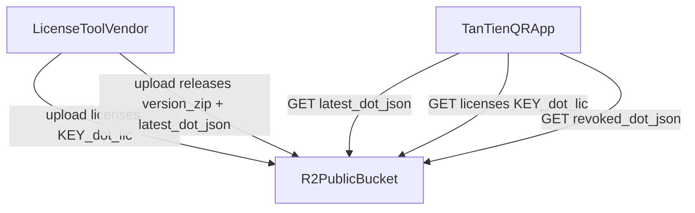

# Auto Update + License Online qua Cloudflare R2

## Mô hình đã chốt
- Chỉ dùng R2 bucket public (không Workers/KV/D1).
- License online = nhập activation-key, app tải file `.lic` tương ứng từ R2 về, verify RSA offline như hiện tại.
- Giữ nhập file `.lic` thủ công như fallback.
- Update = app tự check manifest khi khởi động, có bản mới thì hỏi người dùng rồi tải + cài.

## Bố cục R2 đề xuất
- `releases/latest.json`: gồm `version`, `minimumVersion`, `releaseDateUtc`, `mandatory`, `notesVi`, `packages` (mỗi gói: `fileName`, `url`, `sha256`, `size`, `rid` = win-x64).
- `releases/TanTienQR-<version>-win-x64.zip`: gói cài (chứa `TanTienQR.exe` + `appsettings.json` mẫu, không chứa `license.lic`, `logs/`).
- `licenses/<ACTIVATION-KEY>.lic`: file license đã ký RSA, tên file chính là key (key sinh ngẫu nhiên, khó đoán, ví dụ 3 nhóm base32).
- `licenses/revoked.json`: gồm `updatedUtc` + danh sách `revoked` (mỗi mục: `hwid` hoặc hash của license + `reason`).

## Luồng license online
- Khách gửi HWID (`LicenseManager.Hwid` trong `TanTienQR/Services/LicenseManager.cs`) cho vendor.
- Vendor dùng `tools/LicenseTool` (mở rộng thêm nút sinh key + upload R2 bằng `rclone`/script) tạo `license.lic` bằng `LicenseSigner.Create` trong `ClassLibraryMT/Licensing/LicenseSigner.cs`, đặt tên `<KEY>.lic` rồi upload lên R2.
- Trong app, `LicenseWindow` (`TanTienQR/Views/LicenseWindow.axaml`) thêm ô nhập activation-key + nút Kích hoạt online.
- Service mới `LicenseActivationService`: chuẩn hoá key, `GET https://cdn.domain/licenses/<KEY>.lic`, lưu file tạm, gọi `LicenseValidator.Validate` trong `ClassLibraryMT/Licensing/LicenseValidator.cs`, chỉ copy đè `license.lic` khi `Ok` và `Hwid` khớp máy.
- Kiểm tra thu hồi: sau khi `LicenseManager.Load()` OK, nền tải `revoked.json` (cache 24h trong `logs/`), nếu HWID/kid nằm trong danh sách thì coi như không hợp lệ + hiện lý do.
- Offline: cho phép chạy tiếp nếu đã có license hợp lệ offline, ghi log lần check online cuối; quá grace period (ví dụ 7 ngày không check được) thì cảnh báo trong `LicenseWindow`, không khoá máy đột ngột.

## Luồng auto update
- Thêm `Version`/`InformationalVersion` vào `TanTienQR/TanTienQR.csproj` (hiện chưa có, dùng `AssemblyInformationalVersion` làm version runtime).
- Service mới `UpdateService` (singleton, đăng ký trong `TanTienQR/Services/TanTienAppServices.cs`): đọc section `Update` mới trong `TanTienQR/appsettings.json` (`Enabled`, `ManifestUrl`, `Channel`, `CheckOnStartup`, `CheckIntervalHours`, `AllowPrerelease`).
- Khi app khởi động sau `LicenseManager.Load()` trong `TanTienQR/App.axaml.cs`: gọi `CheckAsync()` nền (timeout ~15s, không chặn UI/login).
- So sánh semver `current < latest`: nếu `latest <= minimumVersion` hoặc `mandatory=true` thì bắt buộc; còn lại hỏi người dùng.
- Tải zip về `%LocalAppData%/TanTienQR/updates/<version>/`, verify `SHA256` + `size` trước khi giải nén.
- Cài đặt kiểu self-replace an toàn trên Windows (exe đang chạy bị khoá): app ghi `update.bat`/`update.ps1`, thoát, script chờ process thoát rồi copy đè `TanTienQR.exe` và restart; giữ `license.lic`, `logs/`, `appsettings.json` của khách (chỉ merge key mới).
- UI: thêm trạng thái update trong tab Dev (`TanTienQR/ViewModels/DevViewModel.cs`) và dialog/border nhắc trong `MainWindow` khi có bản mới; log mọi bước qua `ILogger`.

## Tương thích Native AOT
- Mọi JSON mới (`latest.json`, `revoked.json`, manifest update) dùng `JsonSerializerContext` source-generated riêng (mở rộng theo mẫu `ClassLibraryMT/Licensing/LicenseJsonContext.cs`), không dùng reflection/`ConfigurationBinder`.
- `HttpClient` dùng singleton + `SocketsHttpHandler`, `JsonSerializer.Deserialize(..., Context.Default.T)` với `HttpCompletionOption.ResponseHeadersRead` để tải file lớn.
- Tính SHA256 bằng `SHA256.HashData` trên stream, so chuỗi hex lowercase.
- Đọc version runtime bằng `Assembly.GetExecutingAssembly().GetName().Version` hoặc `AssemblyInformationalVersionAttribute`, không dùng `FileVersionInfo` động.

## Vận hành R2
- Tạo bucket `tantien-releases`, bật public read qua custom domain, `Cache-Control: public, max-age=300` cho `latest.json`/`revoked.json`, `max-age=31536000, immutable` cho file zip versioned.
- Quy trình phát hành: `dotnet publish TanTienQR -c Release -r win-x64`, zip, tính sha256, cập nhật `latest.json`, upload 2 file lên R2 (script `tools/publish-release.ps1` mới).
- Quy trình cấp license: nhập HWID + customer + days vào LicenseTool, sinh key ngẫu nhiên, gọi `LicenseSigner.Create`, lưu `licenses/<KEY>.lic`, upload R2, gửi KEY cho khách qua kênh riêng.

## Rủi ro và chốt
- R2 public nên key phải đủ dài ngẫu nhiên; license vẫn bị ràng buộc HWID + chữ ký RSA nên lộ file cũng không dùng ké được.
- Không có API động nên không giới hạn số lần kích hoạt online theo thời gian thực; bù bằng file `revoked.json` + kiểm tra định kỳ.
- Máy khách không mạng vẫn chạy được nhờ grace period + cache manifest/revoke.
