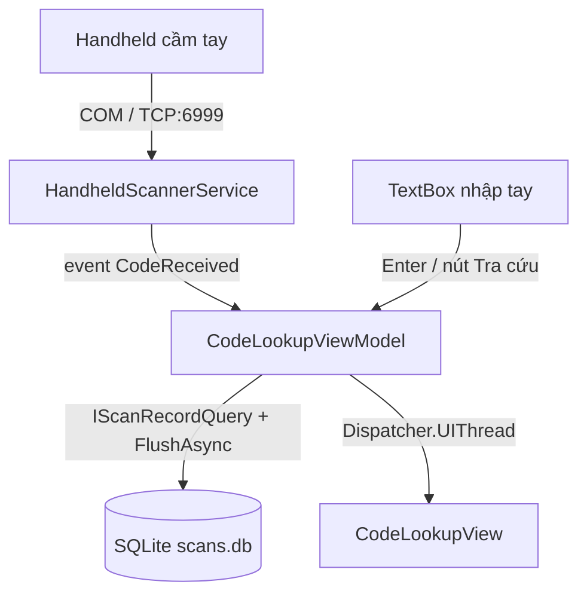

## Tab "Tra cứu mã" — Tra cứu mã đã chạy qua hệ thống

### Quyết định đã chốt
- Ai cũng thấy tab (không thêm quyền mới vào `ClassLibraryMT.Auth` — ma trận quyền dùng chung cho mọi app).
- Kết quả tra cứu gồm **cả hai**: card tóm tắt lần quét gần nhất + bảng lịch sử tất cả các lần quét của mã đó.
- Nguồn dữ liệu: bảng `ScanRecords` (SQLite `logs/scans.db`) — đã có sẵn writer, chỉ cần đọc.



---

### 1. Nguồn dữ liệu tra cứu

Dùng `IScanRecordQuery` (đã đăng ký sẵn trong `AddScanStore`) — `ClassLibraryMT.Scans/ScanRecordEntity.cs`:

- `ScanRecordFilter.CodeContains` → SQL `WHERE (Code LIKE %x% OR Serial LIKE %x% OR Raw LIKE %x%)` (`ClassLibraryMT.Scans/ScanStore.cs`, `QueryAsync`).
- Kết quả đã sort `ReceivedUtc DESC, Id DESC` → phần tử đầu là lần quét gần nhất.
- **Quan trọng:** writer ghi batch (`BatchSize=100`, `FlushIntervalMs=1000`) nên mã vừa quét có thể chưa có trong DB → **gọi `IScanRecordWriter.FlushAsync()` trước khi truy vấn** để thấy ngay lần quét vừa rồi.

### 2. Service nhận mã từ handheld (mới)

`TanTienQR/Services/HandheldScannerService.cs`:
- Singleton + `BackgroundService`-style (Start/Stop thủ công để bật/tắt theo cấu hình), chạy nền, **không chặn UI**.
- Event `event Action<string>? CodeReceived` (fire trên luồng I/O → VM sẽ `Dispatcher.UIThread.Post`).
- `HandheldOptions` (mới, `TanTienQR/Services/HandheldOptions.cs`): `Enabled`, `Mode` (`TcpServer` | `TcpClient`), `TcpHost`, `TcpPort` (6999), `ComPort`, `BaudRate`.
- `TcpServer` (mặc định): `TcpListener` trên `127.0.0.1:6999`, nhận nhiều client, đọc byte, tách khung theo `\r`/`\n` giống `ClassLibraryMT/Communications/CodeReaderProtocol/CodeReader.cs` (`ReceiveFramesAsync`), mỗi khung = 1 mã → phát event.
- `TcpClient`: app đi ra kết nối tới emulator (cho máy handheld thật có WiFi).
- **Điểm mở rộng cho COM (chưa làm, để sau):** cổng COM thật sẽ là một transport khác cùng interface — thêm `SerialPortScannerSource` đọc `System.IO.Ports` (package NuGet `System.IO.Ports`, chỉ win-x64) rồi chuyển `Mode` thành `"Com"`; không sửa UI/VM.
- Script mock để test: `tools/send-scan.ps1` (gửi 1 dòng mã qua TCP 127.0.0.1:6999) — dùng `TcpClient` của PowerShell, không cần cài tool ngoài.

### 3. ViewModel mới — `TanTienQR/ViewModels/CodeLookupViewModel.cs`

- `CodeInput` (string) — nội dung ô nhập tay.
- `IsBusy`, `StatusMessage`, `HasStatus`, `IsEmpty`.
- `Latest` (`CodeLookupRowViewModel?`) — lần quét gần nhất (card tóm tắt) + `OccurrenceCount` (tổng số lần quét), `FirstSeenText` / `LastSeenText`.
- `Rows` (`IReadOnlyList<CodeLookupRowViewModel>`) — lịch sử đầy đủ.
- Lệnh: `LookupCommand` (tra cứu mã đang nhập), `ClearCommand`.
- `CodeLookupRowViewModel` (cùng file): `TimeText`, `CodeText`, `GtinText`, `StatusText` + `IsPass`/`IsWarningOutcome`/`IsInvalid` (class màu badge), `ProcessingTimeText`, `PlcText` — format sẵn để XAML không cần converter (giống `ViewModels/ScanRowViewModel.cs`).
- Nhận mã từ handheld: subscribe `HandheldScannerService.CodeReceived` → tự động set `CodeInput` + chạy tra cứu (dispatch về UI thread).

### 4. View mới — `TanTienQR/Views/CodeLookupView.axaml` (+ `.axaml.cs`)

- Tiêu đề "Tra cứu mã đã quét" + mô tả.
- Thanh tra cứu (`Border Classes="filterBar"`): `TextBox Classes="field"` (nhập tay) + nút `Button Classes="primary"` "Tra cứu" + nút `Classes="soft"` "Xoá". Ô nhập dùng `TextInputOptions.ContentType="Normal"` để bàn phím ảo hiện bàn phím chữ (đã có sẵn `KeyboardService` tự bật khi focus — không cần code thêm).
- Card tóm tắt (dùng `Border Classes="kpi"` / `Classes="panel"`): mã, GTIN, trạng thái, thời điểm quét gần nhất, thời gian xử lý, kết quả gửi PLC, tổng số lần quét.
- Bảng lịch sử: `ItemsControl` + `DataTemplate` (mẫu `Views/InfoView.axaml`), cột: GIỜ / MÃ / GTIN / KẾT QUẢ / XỬ LÝ / GỬI PLC; badge màu theo trạng thái.
- Trạng thái rỗng: "Chưa nhập mã" / "Không tìm thấy mã nào đã quét".
- DataContext dùng chung `MainViewModel` (như các tab khác): binding `{Binding CodeLookup.*}`.

### 5. Nối tab vào shell

- `TanTienQR/Models/AppSection.cs`: thêm `CodeLookup = 7`.
- `TanTienQR/ViewModels/MainViewModel.Tabs.cs`:
  - `IsCodeLookupVisible => CurrentSection == AppSection.CodeLookup` (+ `NotifyPropertyChangedFor`).
  - `ShowCodeLookupTabCommand` (`[RelayCommand] ShowCodeLookupTab`) → `SwitchTo(AppSection.CodeLookup, "Tra cứu mã")` + `CodeLookupView?.LoadCommand.Execute(null)` (nạp sẵn danh sách gần đây).
  - `PageTitle` → `"Tra cứu mã"`; `PageSubtitle` → `"Tra cứu mã đã quét qua camera hoặc handheld cầm tay"`.
- `TanTienQR/ViewModels/MainViewModel.cs`: thêm property `CodeLookupViewModel CodeLookup => _codeLookupView` + inject qua constructor.
- `TanTienQR/Views/MainWindow.axaml`: thêm nút tab "Tra cứu mã" (icon `Path` kiểu kính lúp) trong thanh tab, thêm chip tương ứng trong sidebar "MỤC LỤC", và `<views:CodeLookupView IsVisible="{Binding IsCodeLookupVisible}" />` trong vùng nội dung.

### 6. DI + cấu hình

- `TanTienQR/Services/TanTienAppServices.cs`:
  - `services.AddOptions<HandheldOptions>().Configure<IConfiguration>(...)` (bind thủ công AOT-safe, giống `CameraOptions`) + `ValidateOnStart`.
  - `services.AddSingleton<HandheldScannerService>()`; bật/tắt theo `Enabled` trong `Start()` của service.
  - `services.AddSingleton<CodeLookupViewModel>()`.
- `TanTienQR/appsettings.json` — thêm section:
  ```json
  "Scanner": {
    "Enabled": true,
    "Mode": "TcpServer",
    "TcpHost": "127.0.0.1",
    "TcpPort": 6999,
    "ComPort": "COM3",
    "BaudRate": 9600
  }
  ```

---

### Các file chính sẽ sửa / tạo
| File | Nội dung |
|---|---|
| [TanTienQR/Services/HandheldOptions.cs](d:\DuAn\VisionF\TanTienQR\Services\HandheldOptions.cs) | **Mới** — options cấu hình handheld |
| [TanTienQR/Services/HandheldScannerService.cs](d:\DuAn\VisionF\TanTienQR\Services\HandheldScannerService.cs) | **Mới** — listener TCP :6999, event nhận mã |
| [TanTienQR/ViewModels/CodeLookupViewModel.cs](d:\DuAn\VisionF\TanTienQR\ViewModels\CodeLookupViewModel.cs) | **Mới** — logic tra cứu + row VM |
| [TanTienQR/Views/CodeLookupView.axaml](d:\DuAn\VisionF\TanTienQR\Views\CodeLookupView.axaml) | **Mới** — UI tab |
| [TanTienQR/Views/CodeLookupView.axaml.cs](d:\DuAn\VisionF\TanTienQR\Views\CodeLookupView.axaml.cs) | **Mới** — code-behind |
| [TanTienQR/Models/AppSection.cs](d:\DuAn\VisionF\TanTienQR\Models\AppSection.cs) | Thêm `CodeLookup = 7` |
| [TanTienQR/ViewModels/MainViewModel.Tabs.cs](d:\DuAn\VisionF\TanTienQR\ViewModels\MainViewModel.Tabs.cs) | Cờ hiển thị, lệnh chuyển tab, tiêu đề |
| [TanTienQR/ViewModels/MainViewModel.cs](d:\DuAn\VisionF\TanTienQR\ViewModels\MainViewModel.cs) | Inject + property `CodeLookup` |
| [TanTienQR/Views/MainWindow.axaml](d:\DuAn\VisionF\TanTienQR\Views\MainWindow.axaml) | Nút tab + chip sidebar + view |
| [TanTienQR/Services/TanTienAppServices.cs](d:\DuAn\VisionF\TanTienQR\Services\TanTienAppServices.cs) | Đăng ký options/service/VM |
| [TanTienQR/appsettings.json](d:\DuAn\VisionF\TanTienQR\appsettings.json) | Section `Scanner` |
| [tools/send-scan.ps1](d:\DuAn\VisionF\tools\send-scan.ps1) | **Mới** — script gửi mã mô phỏng handheld |

### Rủi ro / lưu ý
- **Native AOT**: không dùng reflection; `System.IO.Ports` (cho COM) sẽ thêm package NuGet riêng — chưa đưa vào bản này để tránh rủi ro publish AOT; phần COM để mở rộng sau qua `Mode`.
- **Truy vấn `LIKE %code%`**: nếu code dài/sai định dạng sẽ quét nhiều dòng → giới hạn `pageSize` 200 và hiển thị tổng số khớp.
- **Bàn phím ảo** đã tự hoạt động khi focus vào `TextBox` (`Services/KeyboardService.cs`) → không cần tích hợp thêm; chỉ cần ô nhập dùng layout chữ.
- **Đồng bộ DB**: luôn `FlushAsync()` trước khi truy vấn để thấy mã vừa quét (batch writer 1s).
- **Rò bộ nhớ**: listener TCP giữ 1 kết nối/reader task, huỷ khi app tắt qua `Stop()` trong `MainViewModel.Dispose()`.
