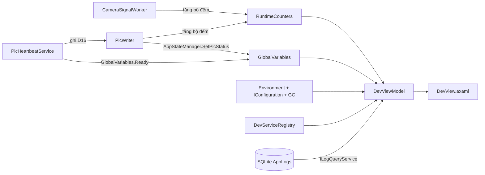

# Dev Page — Bảng theo dõi trạng thái runtime + quản lý bộ nhớ (TanTienQR)

## Mục tiêu

Thêm tab **"Dev"** (chỉ vai trò **Lập trình viên / Developer**) hiển thị trực tiếp, tự làm mới mỗi 1–3 giây:

| Khối | Nguồn dữ liệu |
|---|---|
| Trạng thái global | `GlobalVariables` (app state, camera, PLC, Ready, license, danh sách lỗi) |
| Bộ đếm runtime | `RuntimeCounters` mới (heartbeat, ghi kết quả PLC, quét mã) |
| Ảnh chụp môi trường | `Environment` + `Process` + `IConfiguration` |
| Dịch vụ đăng ký DI | `ServiceDescriptor` capture lúc `AddTanTienServices` |
| Console / log kỹ thuật | Bảng `AppLogs` qua `ILogQueryService.GetAppLogsAsync` |
| **Bộ nhớ (RAM)** | `GC.*` + `Process` + nút giải phóng RAM |

Không lưu file, không ghi DB — thuần "live view".

---

## Kiến trúc luồng dữ liệu



`DevViewModel` tự quản lý 2 timer: **1s** (state + bộ đếm + env + DI + bộ nhớ) và **3s** (tail log). Cả hai chỉ chạy khi tab Dev đang mở (`Activate()` / `Deactivate()`).

---

## 1. Thêm `RuntimeCounters` (mới)

**File:** [TanTienQR/Services/RuntimeCounters.cs](TanTienQR/Services/RuntimeCounters.cs)

Singleton dùng `Interlocked` (đếm từ nhiều luồng: camera worker, heartbeat, PLC writer):

- `HeartbeatWrites` / `HeartbeatFailures` — số lần ghi D16
- `ResultWrites` / `ResultFailures` — số lần ghi D12
- `ScansTotal` / `ScansPass` / `ScansFail` — số mã quét

Đăng ký singleton trong `TanTienAppServices`, inject vào `PlcWriter` và `CameraSignalWorker`.

## 2. Gắn bộ đếm vào các service hiện có

**File:** [TanTienQR/Services/PlcWriter.cs](TanTienQR/Services/PlcWriter.cs)
- Inject `RuntimeCounters`; trong `WriteReadyAsync` tăng `HeartbeatWrites` (và `HeartbeatFailures` khi `!result.IsSuccess`); trong `WriteResultAsync` tăng `ResultWrites` / `ResultFailures`.

**File:** [TanTienQR/Services/CameraSignalWorker.cs](TanTienQR/Services/CameraSignalWorker.cs)
- Inject `RuntimeCounters`; trong `HandleAsync` tăng `ScansTotal` và `ScansPass`/`ScansFail` theo `ScanOutcome`.

## 3. Capture danh sách service DI

**File:** [TanTienQR/Services/DevServiceRegistry.cs](TanTienQR/Services/DevServiceRegistry.cs) (mới)

Đăng ký bằng **factory** để danh sách được chụp *sau khi* host đã build (nên có đủ service của hosting):

```csharp
services.AddSingleton(sp => new DevServiceRegistry(services.ToList()));
```

`DevServiceRegistry` giữ `IReadOnlyList<ServiceDescriptor>`; VM ánh xạ sang `DevServiceRow` (ServiceType / Lifetime / Implementation). `ImplementationType` → tên class, `ImplementationInstance` → tên type, còn lại → `"factory"`.

**File:** [TanTienQR/Services/TanTienAppServices.cs](TanTienQR/Services/TanTienAppServices.cs)
- Đăng ký `RuntimeCounters` (singleton), `DevServiceRegistry` (singleton factory), `DevViewModel` (singleton).
- Thêm `DevServiceRegistry` vào closure sau khi `AddSqliteLogging` / `AddAuth` / `AddPlcSettings` đã đăng ký xong.

## 4. ViewModel cho Dev page

**File:** [TanTienQR/ViewModels/DevRowViewModels.cs](TanTienQR/ViewModels/DevRowViewModels.cs) (mới) — 3 loại dòng:
- `DevKeyValueRow` (Name, Value, Detail, ValueClass) — dùng cho state / bộ đếm / env / config / lỗi / bộ nhớ
- `DevLogRow` (TimeText, Level, Category, Message, LevelClass)
- `DevServiceRow` (ServiceType, Lifetime, Implementation)

**File:** [TanTienQR/ViewModels/DevViewModel.cs](TanTienQR/ViewModels/DevViewModel.cs) (mới)

- Inject: `RuntimeCounters`, `DevServiceRegistry`, `ILogQueryService`, `IConfiguration`.
- Properties: `GlobalStates`, `Counters`, `CurrentErrors`, `EnvironmentRows`, `ConfigRows`, `ServiceRows`, `LogRows`, `MemoryRows`, `ServiceFilter`, `LogCategoryFilter`, `LogMessageFilter`, `SelectedLogLevel`, `LogSummary`, `UptimeText`, `AppVersionText`, `IsLogAutoRefresh`, `MemorySummary`.
- Lệnh `[RelayCommand]`: `RefreshAll`, `ClearServiceFilter`, `RefreshLogs`, `CollectGarbage`.
- `Activate()` / `Deactivate()` bật/tắt timer; `Dispose()` dọn timer.
- Lọc log bằng `AppLogFilter { MinLevel, CategoryContains, MessageContains }`, `pageSize: 200`, `page: 1`.
- Mức log: dùng `Microsoft.Extensions.Logging.LogLevel` làm ComboBox source (AOT-safe, không dùng reflection để liệt kê enum).

## 5. View

**File:** [TanTienQR/Views/DevView.axaml](TanTienQR/Views/DevView.axaml) + [TanTienQR/Views/DevView.axaml.cs](TanTienQR/Views/DevView.axaml.cs) (mới)

Bố cục `Grid RowDefinitions="Auto,Auto,*"`: tiêu đề + badge phiên bản · thanh công cụ (nút làm mới, nút **Giải phóng RAM**, bộ lọc log, bật/tắt tự làm mới) · `ScrollViewer` chứa `Grid` 2 cột các `Border Classes="panel"`:

1. TRẠNG THÁI GLOBAL — bảng Name/Value (app state, camera, PLC, Ready, license)
2. LỖI HIỆN TẠI — `GlobalVariables.Errors` (mã + message + thời điểm)
3. BỘ ĐẾM RUNTIME — heartbeat / ghi PLC / quét mã / uptime
4. **BỘ NHỚ (RAM)** — xem mục 7.2
5. MÔI TRƯỜNG — OS, .NET version, CPU count, process id, thư mục ứng dụng, machine name
6. CẤU HÌNH ĐỌC ĐƯỢC — `IConfiguration.AsEnumerable()` dạng key=value
7. DỊCH VỤ ĐĂNG KÝ (DI) — bảng + ô lọc theo tên service
8. LOG KỸ THUẬT (AppLogs) — bảng tail, span 2 cột, badge màu theo mức

Chỉ dùng lại class style đã có trong [TanTienQR/App.axaml](TanTienQR/App.axaml): `panel`, `kpi`, `label`, `mono`, `sectionTitle`, `badge`, `field`, `chip`, `primary`, `soft`, `device`.

## 6. Nối tab Dev vào điều hướng

**File:** [TanTienQR/Models/AppSection.cs](TanTienQR/Models/AppSection.cs)
- Thêm `Dev = 6` (append cuối để không đổi giá trị cũ).

**File:** [TanTienQR/ViewModels/MainViewModel.Tabs.cs](TanTienQR/ViewModels/MainViewModel.Tabs.cs)
- `public bool CanViewDev => _session.CurrentRole == UserRole.Developer;` — kiểm tra **trực tiếp vai trò**, KHÔNG thêm cờ `Permission` mới (giữ nguyên ma trận quyền của lib `ClassLibraryMT.Auth` cho app khác).
- `IsDevVisible => CurrentSection == AppSection.Dev && CanViewDev;` + `[NotifyPropertyChangedFor]`.
- `[RelayCommand] ShowDevTab()` → `SwitchTo(AppSection.Dev, "Dev")` và `DevView.Activate()`.
- `SwitchTo`: khi rời khỏi Dev → `DevView.Deactivate()`.
- `PageTitle` → "Dev"; `PageSubtitle` → "Trạng thái runtime, bộ đếm, bộ nhớ, log kỹ thuật — dành cho nhà phát triển".
- `RefreshPermissionFlags()`: thêm `CanViewDev`, `IsDevVisible`.

**File:** [TanTienQR/ViewModels/MainViewModel.cs](TanTienQR/ViewModels/MainViewModel.cs)
- Inject `DevViewModel`, expose `public DevViewModel DevView => _devView;`
- `Dispose()` và `Stop()` gọi `DevView.Dispose()` / `DevView.Deactivate()`.

**File:** [TanTienQR/Views/MainWindow.axaml](TanTienQR/Views/MainWindow.axaml)
- Nút tab "Dev" trên header (`Classes.active="{Binding IsDevVisible}"`, `IsVisible="{Binding CanViewDev}"`, `Command="{Binding ShowDevTabCommand}"`).
- Mục "Dev" trong sidebar, nhóm **NHÀ PHÁT TRIỂN** (`IsVisible="{Binding CanViewDev}"`).
- `<views:DevView IsVisible="{Binding IsDevVisible}" />` trong vùng nội dung tab.

---

## 7. Giải phóng RAM & chặn rò bộ nhớ

### 7.1 Nút "Giải phóng RAM" (`CollectGarbage`)

**File:** [TanTienQR/ViewModels/DevViewModel.cs](TanTienQR/ViewModels/DevViewModel.cs)

```csharp
[RelayCommand]
private void CollectGarbage()
{
    // Gen 2 + Aggressive = compacting + blocking -> thu gom ngay và nén heap.
    GC.Collect(GC.MaxGeneration, GCCollectionMode.Aggressive, blocking: true, compacting: true);

    // Đợi các finalizer chạy xong (object có finalizer giữ lại bộ nhớ tới khi
    // finalizer chạy) -> sau đó GC lần nữa để thu hồi phần vừa giải phóng.
    GC.WaitForPendingFinalizers();
    GC.Collect(GC.MaxGeneration, GCCollectionMode.Forced, blocking: true, compacting: true);

    MemorySummary = $"Đã giải phóng bộ nhớ lúc {DateTime.Now:HH:mm:ss}.";
}
```

Ghi log thao tác qua `IUserActionLogger` (`Dev.GC.Collect`) để có dấu vết trong Lịch sử.

> Lưu ý: `GC.Collect` **không** làm app "chậm lại vĩnh viễn" — nó chỉ tốn vài chục ms. Nhưng không nên gọi tự động; chỉ khi người dùng bấm nút.

### 7.2 Panel bộ nhớ (RAM)

Cập nhật mỗi lần timer 1s tick:

| Chỉ số | API | Ý nghĩa |
|---|---|---|
| RAM thực của process | `Process.GetCurrentProcess().WorkingSet64` | Bộ nhớ thật đang chiếm trong RAM |
| Peak working set | `Process.PeakWorkingSet64` | Đỉnh cao nhất từng ghi nhận |
| Managed memory hiện tại | `GC.GetTotalMemory(false)` | Heap managed đang dùng |
| Tổng đã cấp phát | `GC.GetTotalAllocatedBytes()` | Tổng số byte đã cấp từ đầu app |
| Working set của .NET | `Environment.WorkingSet` | Bộ nhớ tiến trình .NET |
| Số lần GC gen 0/1/2 | `GC.CollectionCount(n)` | Tần suất GC |
| Latency mode | `GCSettings.LatencyMode` | Chế độ GC đang dùng |

Hiển thị dạng Name/Value (dùng `DevKeyValueRow`) + `MemorySummary` (dòng tóm tắt: "RAM 148 MB · Managed 62 MB · GC gen2 12 lần").

### 7.3 Sửa 2 channel `unbounded` → `bounded` (chặn rò RAM dài hạn)

**File:** [TanTienQR/Services/CameraSignalWorker.cs](TanTienQR/Services/CameraSignalWorker.cs)

Hiện tại: `Channel.CreateUnbounded<string>()` — nếu worker xử lý chậm hơn tốc độ camera đẩy frame, hàng đợi phình vô hạn.

```csharp
// Bounded + DropOldest: camera callback dùng TryWrite (không bao giờ chặn).
// Khi đầu thì frame cũ bị bỏ — chấp nhận được vì UI chỉ giữ 200 dòng gần nhất.
private readonly Channel<string> _queue = Channel.CreateBounded<string>(
    new BoundedChannelOptions(CameraQueueCapacity)
    {
        FullMode = BoundedChannelFullMode.DropOldest,
        SingleReader = true,
    });

private const int CameraQueueCapacity = 512;
```

**File:** [TanTienQR/Services/ScanFeed.cs](TanTienQR/Services/ScanFeed.cs)

Hiện tại: `Channel.CreateUnbounded<ScanRecord>()` — nếu consumer chết (xem 7.4) thì channel phình vô hạn, **không ai dọn**.

```csharp
private const int FeedCapacity = 1000;

private readonly Channel<ScanRecord> _channel = Channel.CreateBounded<ScanRecord>(
    new BoundedChannelOptions(FeedCapacity)
    {
        // DropOldest: nếu UI bị treo, bỏ bản ghi cũ thay vì nuốt hết RAM.
        FullMode = BoundedChannelFullMode.DropOldest,
        SingleReader = true,
        SingleWriter = false,
    });
```

### 7.4 Vá lỗ hổng: consumer của `ScanFeed` có thể chết âm thầm

**File:** [TanTienQR/ViewModels/MainViewModel.cs](TanTienQR/ViewModels/MainViewModel.cs)

Hiện tại `ConsumeFeedAsync` chỉ bắt `OperationCanceledException`:

```csharp
catch (OperationCanceledException)
{
    // Shutdown bình thường.
}
```

Nếu `Dispatcher.UIThread.InvokeAsync(() => AddScan(record))` ném exception khác (VD `AddScan` lỗi do `ObservableCollection` bị sửa đồng thời), task sẽ **fault âm thầm** → không ai đọc `ScanFeed` nữa → channel unbounded phình to theo thời gian (rò RAM không kiểm soát). Sửa:

```csharp
catch (Exception ex)
{
    // KHÔNG để consumer chết: nếu task này kết thúc thì không ai đọc
    // ScanFeed nữa -> hàng đợi phình vô hạn (rò bộ nhớ).
    _logger.LogError(ex, "Lỗi trong luồng đọc kênh kết quả quét mã.");
}
```

Cần inject `ILogger<MainViewModel>` vào `MainViewModel`.

### 7.5 Nguồn rò RAM đã kiểm tra — không cần sửa

| Nơi | Kết luận |
|---|---|
| `SqliteLogWriter._queue` | Đã bounded 20 000 + `DropOldest` → an toàn |
| `MainViewModel.Scans` / `Events` | Đã giới hạn 200 / 8 dòng → an toàn |
| `AppStateManager._errors` | Đã giới hạn 50 lỗi → an toàn |
| `FinsUdpTransport._buffer` | Buffer cố định 2048 byte, tái dùng → an toàn |
| `CameraSignalWorker._recent` | Dọn mã cũ theo cửa sổ trùng → tự giới hạn |

---

## Ghi chú kỹ thuật

- **AOT-safe**: không dùng `Type.GetType`, `Activator.CreateInstance`, `ConfigurationBinder.GetValue<T>` hay reflection liệt kê enum. Danh sách DI lấy từ `ServiceDescriptor` đã đăng ký (không cần scan assembly).
- **Không đụng `ClassLibraryMT.Auth`** — ma trận quyền và enum `Permission` giữ nguyên; Dev tab dùng so sánh vai trò trực tiếp.
- **Không chặn UI**: đọc `AppLogs` mở connection riêng (WAL cho đọc song song với writer) — đúng như `LogQueryService` hiện tại.
- Timer của Dev page chỉ chạy khi tab đang mở → không tăng tải khi người dùng ở tab khác.
- `Process.GetCurrentProcess()` trả về `IDisposable` → phải `using` trong hàm dựng dòng để không rò handle.
- `IUserActionLogger` sẽ tự ghi thao tác `Tab.Switch` khi mở tab Dev (đã có sẵn trong `SwitchTo`) — không cần thêm gì.

## Kiểm tra sau khi triển khai

1. `dotnet build TanTienQR\TanTienQR.csproj -c Debug` — không lỗi biên dịch.
2. Đăng nhập bằng tài khoản **Lập trình viên** → thấy tab Dev; đăng nhập bằng **Quản trị** → không thấy tab Dev.
3. Mở tab Dev: các bảng có dữ liệu; đổi trạng thái camera/PLC → cột Value cập nhật trong ~1s.
4. Log kỹ thuật hiện dòng mới nhất; lọc theo mức `Error` và theo category `Plc` hoạt động.
5. Bấm "Giải phóng RAM" → số Managed memory giảm, `MemorySummary` cập nhật, app vẫn phản hồi.
6. Đăng xuất rồi đăng nhập lại → tab Dev vẫn hoạt động, timer không bị nhân bản.
7. Chạy app ở chế độ debug > 30 phút với camera giả lập đẩy mã liên tục → RAM ổn định (không tăng tuyến tính).
