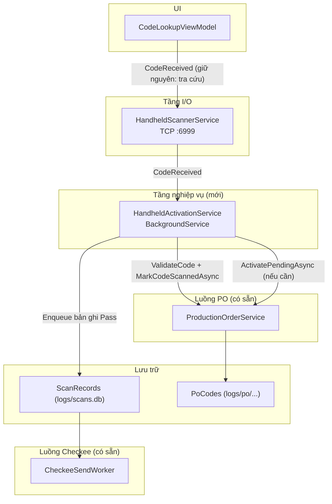

# Tính năng kích hoạt mã bằng máy quét cầm tay (Handheld)

## Bối cảnh hiện tại

Hạ tầng handheld **đã có sẵn** và đang hoạt động, chỉ thiếu phần "kích hoạt":

- [`TanTienQR/Services/HandheldScannerService.cs`](TanTienQR/Services/HandheldScannerService.cs) — TCP server/client, tách khung theo CR/LF, phát `event Action<string>? CodeReceived`. Được `Start()` trong [`TanTienQR/App.axaml.cs:124`](TanTienQR/App.axaml.cs).
- [`TanTienQR/Services/HandheldOptions.cs`](TanTienQR/Services/HandheldOptions.cs) — cấu hình `Scanner:*` (Enabled / Mode / TcpHost / TcpPort / ComPort / BaudRate). ComPort mới chỉ là chỗ để dành.
- **Điểm mấu chốt:** `CodeReceived` hiện chỉ được subscribe ở [`TanTienQR/ViewModels/CodeLookupViewModel.cs:68`](TanTienQR/ViewModels/CodeLookupViewModel.cs) với mục đích **tra cứu lịch sử**, không kích hoạt gì.

Hai luồng "kích hoạt" đang tồn tại:
- **PO Server**: `ProductionOrderService.ActivatePendingAsync()` → `POST /api/activate` ([`ClassLibraryMT.Po/ProductionOrderService.cs:700`](ClassLibraryMT.Po/ProductionOrderService.cs))
- **Checkee**: `CheckeeSendWorker` gom mã `SendStatus = Pending` + `Status = Pass` → `POST /middleware-api/CTEs/active` ([`TanTienQR/Services/CheckeeSendWorker.cs:195`](TanTienQR/Services/CheckeeSendWorker.cs))

## Quyết định đã chốt

| Hạng mục | Quyết định |
|---|---|
| Phạm vi kích hoạt | **Cả hai**: PO Server + Checkee |
| Ghi PLC | **Không** (`PlcResult = Skipped`) |
| Mã không thuộc PO đang chạy | **Ghi bản ghi `Fail`** vào `logs/scans.db` để có dấu vết, **không** gửi lên Checkee/PO Server |
| UI | Mở rộng tab **"Tra cứu mã"** (`CodeLookupViewModel` / `CodeLookupView.axaml`) |

## Kiến trúc đề xuất



**Điểm mấu chốt:** `HandheldScannerService` phát `CodeReceived` cho **nhiều subscriber** — không được thay thế subscriber hiện tại của `CodeLookupViewModel`. Service mới sẽ là subscriber thứ hai.

---

## Các bước triển khai

### 1. Tạo `HandheldActivationService` (file mới)

[`TanTienQR/Services/HandheldActivationService.cs`](TanTienQR/Services/HandheldActivationService.cs)

Singleton + `BackgroundService`, đăng ký cùng `CameraSignalWorker`. Subscribe `CodeReceived` trong `ExecuteAsync`, unsubscribe khi dừng.

**Luồng xử lý một mã handheld** (chạy trên luồng nền, không chặn luồng đọc socket):

1. Parse bằng [`QrParser.TryParse`](TanTienQR/Services/QrParser.cs) → `(gtin, serial)`. Không parse được → ghi bản ghi `Fail` + `Raw` = mã gốc, kết thúc.
2. Gọi `_po.ValidateCode(gtin, serial)` ([`ClassLibraryMT.Po/ProductionOrderService.cs:622`](ClassLibraryMT.Po/ProductionOrderService.cs)):
   - `Halted` → ghi `Fail` (mã bị từ chối do dừng máy), kết thúc.
   - `NoProductionOrder` → ghi `Fail`, kết thúc (không kích hoạt).
   - `InvalidForOrder` / `Duplicate` → ghi `Fail` + `OrderNo` = PO đang chạy, kết thúc.
   - `Valid` → tiếp tục bước 3.
3. `_po.MarkCodeScannedAsync(gtin, serial)` → ghi `ScannedUtc`/`Status='Scanned'` vào `PoCodes` của PO đang chạy + set cờ `Scanned` trong `PoCodeCache`.
4. Ghi bản ghi vào `ScanRecords` qua `IScanRecordWriter.Enqueue` với:
   - `Status = ScanStatuses.Pass`
   - `PlcResult = ScanPlcResults.Skipped` (không ghi PLC)
   - `OrderNo = _po.CurrentOrder?.OrderNo`
   - `BatchNo = ScanBatchDefaults.NoBatch`
   - `Gtin` / `Serial` / `Raw` đã parse
   - `ProcessingTimeMs` đo bằng `Stopwatch` (giống `CameraSignalWorker.MeasureProcessingMs`)
   - `SendStatus` để trống → `ScanSendStatusStore.GetPendingAsync` coi là `Pending` → `CheckeeSendWorker` sẽ tự gửi lên Checkee ở chu kỳ kế tiếp (đúng mục tiêu "cả hai", không cần gọi HTTP trực tiếp).
5. Ghi PO Server: sau khi đánh dấu scanned, **không** gọi `ActivatePendingAsync()` ngay từ service (tránh nhiều HTTP call khi quét liên tục). Thay vào đó kích hoạt PO Server **theo lô định kỳ** — xem bước 2.

**Bảo đảm không trùng lặp:** `MarkCodeScannedAsync` đã trả về sớm nếu mã đã quét (race 2 luồng) → service handheld chỉ ghi bản ghi `Pass` khi `ValidateCode` trả `Valid`.

**Không ghi PLC:** tuyệt đối không gọi `IPlcWriter.WriteResultAsync` trong service này (tránh xung đột với camera đang ghi D12).

### 2. Kích hoạt PO Server theo lô định kỳ

Tái sử dụng `PoActivationWorker` hiện có ([`TanTienQR/Services/PoActivationWorker.cs`](TanTienQR/Services/PoActivationWorker.cs)) — nó đã chạy mỗi 2.5s và gọi `ActivatePendingAsync()` khi có PO `Running`.

**Vấn đề cần giải quyết:** `ActivatePendingAsync()` lấy mã từ `PoStore.GetPendingActivationCodesAsync` — tức mã có `ActivatedUtc IS NULL`, **không giới hạn theo `ScannedUtc`**. Nghĩa là mã handheld đánh dấu scanned sẽ được gửi lên PO Server đúng như mã camera — **đây chính là hành vi mong muốn** và không cần sửa `PoActivationWorker`.

**Cần kiểm tra lại trong lúc triển khai:** `PoStore.MarkActivatedAsync` (`WHERE Code = $code OR Serial = $code`) cập nhật theo **Serial**, còn `GetPendingActivationCodesAsync` trả về `Serial` → nhất quán. Không cần sửa.

**Vậy kết luận:** bước 2 **không cần code mới** — `PoActivationWorker` + `ActivatePendingAsync` đã xử lý. Chỉ cần đảm bảo `MarkScannedAsync` được gọi đúng (bước 1.3) để mã có mặt trong `PoCodes` và không bị coi là trùng.

> Lưu ý kiểm tra chéo: `PoStore.MarkScannedAsync` dùng `WHERE Gtin || '|' || Serial = $code OR Code = $code OR Serial = $code` — với `$code` = `"gtin|serial"` sẽ khớp nhánh đầu. OK.

### 3. Mở rộng UI tab "Tra cứu mã"

[`TanTienQR/ViewModels/CodeLookupViewModel.cs`](TanTienQR/ViewModels/CodeLookupViewModel.cs):

- Thêm `HandheldActivationService` vào constructor (singleton, DI sẽ inject).
- Thêm thuộc tính hiển thị:
  - `HandheldStatusText` — trạng thái kết nối handheld (đọc từ `HandheldScannerService.StatusText` qua timer hiện có).
  - `LastHandheldCodeText` / `LastHandheldResultText` — mã vừa quét và kết quả (Pass / Fail + lý do).
  - `HandheldPassCount` / `HandheldFailCount` — bộ đếm riêng cho handheld (độc lập với `TotalScans` của camera).
- `OnHandheldCodeReceived` hiện tại: giữ nguyên hành vi tra cứu, **nhưng** chỉ tra cứu khi tab đang active; service kích hoạt chạy độc lập nên mọi lần quét đều được kích hoạt dù người dùng đang ở tab khác.

[`TanTienQR/Views/CodeLookupView.axaml`](TanTienQR/Views/CodeLookupView.axaml):

- Thêm 1 panel "Kích hoạt bằng máy quét cầm tay" ngay dưới thanh tra cứu: badge trạng thái kết nối, mã vừa quét, kết quả, bộ đếm Pass/Fail.
- Thêm cột "Nguồn" (Camera / Handheld) trong bảng kết quả → cần thêm cột trong DB hoặc suy ra từ `PlcResult = Skipped` + `Raw` khác rỗng. **Cách nhẹ nhất:** suy ra nguồn từ `PlcResult`:
  - camera + Pass → `PlcResult = Ok`
  - handheld → `PlcResult = Skipped`
  → `IsFromHandheld => PlcText == "Bỏ qua" && StatusText == "Pass"`.
  Nếu cần phân biệt chính xác tuyệt đối, thêm cột `Source` mới vào bảng `ScanRecords` (kèm migration trong `ClassLibraryMT.Scans`).

### 4. Cấu hình

[`TanTienQR/Services/AppConfigModels.cs`](TanTienQR/Services/AppConfigModels.cs) — thêm vào `ScannerConfig`:

- `AutoActivate` (bool, mặc định `true`) — có tự kích hoạt mã handheld hay không. Khi `false`, mã chỉ được ghi nhận, người dùng bấm nút "Kích hoạt mã handheld" thủ công.
- `RequireRunningOrder` (bool, mặc định `true`) — có bắt buộc có PO đang chạy mới kích hoạt hay không.

Cần cập nhật đồng bộ 3 nơi (theo pattern hiện có):
- [`TanTienQR/Services/AppConfigModels.cs`](TanTienQR/Services/AppConfigModels.cs) — struct `ScannerConfig` + `[ConfigField]`.
- [`TanTienQR/Services/HandheldOptions.cs`](TanTienQR/Services/HandheldOptions.cs) — thêm 2 property tương ứng.
- [`TanTienQR/Services/TanTienAppServices.cs:156`](TanTienQR/Services/TanTienAppServices.cs) — bind thủ công (AOT-safe) + `.Validate`.
- [`TanTienQR/Services/ConfigValidation.cs:47`](TanTienQR/Services/ConfigValidation.cs) — validate.
- Cập nhật test: [`tools/ConfigTests/Program.cs`](tools/ConfigTests/Program.cs), [`tools/ConfigUiTests/Program.cs`](tools/ConfigUiTests/Program.cs).

### 5. Đăng ký DI

[`TanTienQR/Services/TanTienAppServices.cs`](TanTienQR/Services/TanTienAppServices.cs):

```csharp
services.AddSingleton<HandheldActivationService>();
services.AddHostedService(sp => sp.GetRequiredService<HandheldActivationService>());
```

Đăng ký **sau** `AddProductionOrders` (cần `ProductionOrderService`) và **sau** `AddScanStore` (cần `IScanRecordWriter`).

---

## Rủi ro & điểm cần lưu ý

1. **Double-subscribe `CodeReceived`:** `CodeLookupViewModel` và `HandheldActivationService` đều subscribe. Event `Action<string>` hỗ trợ nhiều subscriber — OK, nhưng phải đảm bảo `CodeLookupViewModel.Dispose()` không unsubscribe nhầm (hiện tại chỉ gỡ của chính nó → đúng).

2. **Thứ tự subscribe vs. `_intake.Dispatch`:** `HandheldScannerService.EmitFrame` gọi `_intake.Dispatch(() => CodeReceived?.Invoke(code))`. `_intake` bị suspend khi bảo trì cập nhật → handheld cũng bị chặn trong thời gian đó. Điều này là đúng (nhất quán với camera).

3. **Race với `PoActivationWorker`:** cả `PoActivationWorker` và `HandheldActivationService` có thể gọi `MarkScannedAsync`/`ActivatePendingAsync` đồng thời. `PoStore` đã có `_mutationGate` (`AcquireMutationLockAsync`) bảo vệ các thao tác đổi trạng thái → an toàn. Nhưng `ActivatePendingAsync` **không** dùng `mutationGate` → 2 lời gọi song song có thể gửi trùng lên server. Cần kiểm tra/khóa riêng cho `ActivatePendingAsync` trong `ProductionOrderService`.

4. **Checkee `BatchCode` rỗng:** `CheckeeSendWorker` đánh dấu `Failed` nếu thiếu GTIN hoặc batch code ([`CheckeeSendWorker.cs:234`](TanTienQR/Services/CheckeeSendWorker.cs)). Mã handheld parse được GTIN từ QR → OK; nhưng `BatchCode` lấy từ `CheckeeOptions.BatchCode` (cấu hình) → nếu chưa cấu hình thì mã handheld sẽ vào bảng "Mã gửi lỗi". Cần hiển thị cảnh báo rõ ràng trong UI.

5. **Chống trùng lịch sử toàn cục (`HaltAsync`):** `ActivatePendingAsync` kiểm tra mã đã từng quét trong `logs/scans.db` trước khi gửi. Vì mã handheld **được ghi vào `ScanRecords`** với `OrderNo` = PO đang chạy, cơ chế này vẫn hoạt động đúng — không tạo false-positive.

6. **Hiệu năng:** mỗi lần quét handheld = 1 `ValidateCode` (RAM, O(1)) + 1 `MarkScannedAsync` (SQLite UPDATE, có thể full-scan vì `Gtin || '|' || Serial` không dùng index) + 1 `Enqueue` (async). Chấp nhận được ở tần suất quét tay, nhưng nên ghi nhận để cải thiện sau.

---

## Trình tự thực hiện

| # | Việc | File |
|---|---|---|
| 1 | Thêm cấu hình `AutoActivate`, `RequireRunningOrder` | `HandheldOptions.cs`, `AppConfigModels.cs`, `TanTienAppServices.cs`, `ConfigValidation.cs` |
| 2 | Tạo `HandheldActivationService` | file mới `TanTienQR/Services/HandheldActivationService.cs` |
| 3 | Đăng ký DI | `TanTienAppServices.cs` |
| 4 | Rà soát race `ActivatePendingAsync` (thêm khoá nếu cần) | `ClassLibraryMT.Po/ProductionOrderService.cs` |
| 5 | Mở rộng UI tab Tra cứu mã | `CodeLookupViewModel.cs`, `CodeLookupView.axaml` |
| 6 | Bổ sung test | `tools/PoTests/Program.cs`, `tools/ConfigTests/Program.cs` |

## Điểm cần xác nhận trước khi code

- Cột "Nguồn" trong bảng tra cứu: **suy ra từ `PlcResult`** (nhẹ, không migration) hay **thêm cột `Source` thật** vào `ScanRecords` (chính xác, cần migration)?
- `RequireRunningOrder = false` có nên cho phép kích hoạt mà không cần PO đang chạy? (khi đó chỉ kích hoạt Checkee, bỏ qua PO Server)
