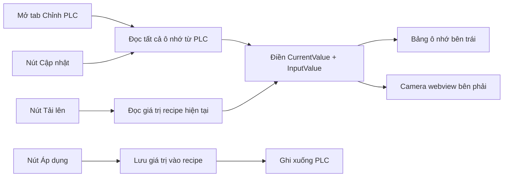

## Tổng quan

Trang [TanTienQR/Views/PlcSettingsView.axaml](TanTienQR/Views/PlcSettingsView.axaml) và [TanTienQR/ViewModels/PlcSettingsViewModel.cs](TanTienQR/ViewModels/PlcSettingsViewModel.cs) sẽ được sửa theo 7 yêu cầu. Luồng dữ liệu mới:



## 1. Tự động tải lại giá trị PLC

**File:** [TanTienQR/ViewModels/PlcSettingsViewModel.cs](TanTienQR/ViewModels/PlcSettingsViewModel.cs)

- Tách `LoadAsync()` thành 2 phần: `LoadDefinitionsAsync()` (lấy tham số + recipe từ DB) và `ReadAllValuesAsync()` (đọc giá trị thực tế từ PLC).
- `ReadAllAsync()` hiện tại có lỗi: đọc hết kết quả rồi gán theo **chỉ số** `ParameterRows[i]` — nếu thứ tự DB khác thứ tự danh sách thì giá trị sẽ gán nhầm ô nhớ. Sửa lại: đổi kiểu trả về của `IPlcSettingsService.ReadAllAsync()` để kèm theo `ParameterId`, hoặc trong VM tra cứu `GetParametersAsync()` rồi dùng `Id` để khớp.
- Thêm command mới `RefreshAllCommand` = load định nghĩa + đọc lại giá trị PLC + nạp giá trị recipe vào ô nhập.
- `ReadAllValuesAsync()` cung cấp giá trị cho cả `CurrentValue` (giá trị thực tế của PLC) và `InputValue` (giá trị trong recipe) — để "Tải lên" gán `InputValue` từ recipe, còn "Cập nhật" gán `CurrentValue` từ PLC.

**File:** [TanTienQR/ViewModels/MainViewModel.Tabs.cs](TanTienQR/ViewModels/MainViewModel.Tabs.cs)

- `ShowPlcSettingsTab()` hiện gọi `PlcSettings?.LoadCommand.Execute(null)`. Đổi thành `PlcSettings?.RefreshAllCommand.Execute(null)` để **mở tab luôn đọc giá trị PLC** (yêu cầu 1).

## 2. Bỏ các nút phía trên cùng bên phải

**File:** [TanTienQR/Views/PlcSettingsView.axaml](TanTienQR/Views/PlcSettingsView.axaml)

- Xóa `StackPanel` chứa 3 nút `Tải lại` / `Đọc tất cả` / `+ Tham số` ở header (dòng ~127-150).
- Header chỉ còn tiêu đề + badge + mô tả.

## 3. Footer bảng ô nhớ: thêm 3 nút

**File:** [TanTienQR/Views/PlcSettingsView.axaml](TanTienQR/Views/PlcSettingsView.axaml)

Footer hiện tại (đường viền dưới bảng, dòng ~590) có 1 nút `Lưu vào recipe`. Thay bằng 3 nút canh phải, đều chiều cao 36:

| Nút | Command mới | Hành động |
|---|---|---|
| **Tải lên** | `LoadRecipeValuesCommand` | Đọc giá trị recipe hiện tại từ DB, gán vào `InputValue` các dòng |
| **Cập nhật** | `ReadAllCommand` (giá trị PLC) | Đọc lại tất cả ô nhớ từ PLC, gán vào `CurrentValue` |
| **Áp dụng** | `ApplyAndSaveRecipeCommand` | Lưu `InputValue` vào recipe, rồi ghi xuống PLC |

- `ApplyAndSaveRecipeCommand` = `SaveRecipeValuesAsync()` + ghi từng `InputValue` đang nhập xuống PLC (không dùng giá trị đã lưu trong recipe) — để "Áp dụng" nghĩa là gửi giá trị người đang nhập xuống PLC **và** lưu lại vào recipe.
- Nút `Lưu vào recipe` riêng sẽ được bỏ, vì `Áp dụng` đã ghi cả hai việc.

## 4. Nút thêm tham số ở phải bảng ô nhớ

**File:** [TanTienQR/Views/PlcSettingsView.axaml](TanTienQR/Views/PlcSettingsView.axaml)

- Xóa nút `+ Tham số` ở header.
- Thêm nút `+ Tham số` vào header panel của bảng ô nhớ, canh phải (cho với dòng chữ "Nhấn ▼ để xem chi tiết"), dùng `Command="{Binding PlcSettings.AddParameterCommand}"`.
- Command `AddParameter` hiện tại đã thêm dòng nháp inline trong bảng — giữ nguyên.

## 5. Sửa hiển thị tên Recipe sai

**File:** [ClassLibraryMT.Plc/PlcModels.cs](ClassLibraryMT.Plc/PlcModels.cs)

Nguyên nhân: `ComboBox` hiện `ClassLibraryMT.Plc.PlcRecipe` vì `PlcRecipe` không override `ToString()`. Sửa tại model (đúng, mọi nơi đều dùng được):

```csharp
/// <summary>Tên hiển thị trong ComboBox.</summary>
public override string ToString() =>
    string.IsNullOrWhiteSpace(Name) ? $"Recipe #{Id}" : Name;
```

**Phương án thay thế ít xâm lấn hơn:** thêm `ItemTemplate` trong XAML với `TextBlock Text="{Binding Name}"`. Chọn cách `ToString()` vì ít code hơn và dùng được cho mọi nơi.

## 6. Xoá Recipe phải hỏi mật khẩu

**File mới:** [TanTienQR/ViewModels/RecipeDeleteConfirmViewModel.cs](TanTienQR/ViewModels/RecipeDeleteConfirmViewModel.cs) + [TanTienQR/Views/RecipeDeleteConfirmWindow.axaml](TanTienQR/Views/RecipeDeleteConfirmWindow.axaml) + `.axaml.cs`

- Hộp thoại nhỏ (`Width=400`), nội dung: tên recipe cần xoá + ô nhập `PasswordChar="•"` + nút `Xoá` / `Huỷ`.
- VM dùng `IUserService.AuthenticateAsync(username, password)` để xác thực mật khẩu của người đang đăng nhập (`ISessionContext.CurrentUser.Username`).
- VM expose `IsConfirmed` (bool) để code-behind biết kết quả.
- **Tái sử dụng pattern:** sao cấu trúc từ [TanTienQR/Views/PlcParamEditWindow.axaml.cs](TanTienQR/Views/PlcParamEditWindow.axaml.cs) — `VirtualKeyboardHost.Attach(this)` + `KeyboardDialogSizer.Attach(this, ...)` để bàn phím ảo hoạt động trong hộp thoại.

**File:** [TanTienQR/ViewModels/PlcSettingsViewModel.cs](TanTienQR/ViewModels/PlcSettingsViewModel.cs)

- Inject thêm `IUserService` + `ISessionContext` vào constructor.
- `DeleteRecipeAsync()`: mở hộp thoại xác nhận trước, chỉ xoá khi `IsConfirmed == true`.
- Ghi log `Plc.Recipe.Delete` **kèm kết quả thất bại** khi mật khẩu sai.

## 7. Ẩn/hiện tab tham số PLC (chỉ hiện camera)

**File:** [TanTienQR/ViewModels/PlcSettingsViewModel.cs](TanTienQR/ViewModels/PlcSettingsViewModel.cs)

- Thêm `[ObservableProperty] public partial bool IsParameterPanelVisible { get; set; } = true;`
- Thêm `[RelayCommand] private void ToggleParameterPanel() => IsParameterPanelVisible = !IsParameterPanelVisible;`

**File:** [TanTienQR/Views/PlcSettingsView.axaml](TanTienQR/Views/PlcSettingsView.axaml)

- Nút toggle nhỏ (icon 2 mũi tên) đặt ở header panel của bảng ô nhớ hoặc trên header trang.
- Bind `IsVisible="{Binding PlcSettings.IsParameterPanelVisible}"` cho **cột trái** (Grid chứa Recipe + bảng ô nhớ).
- Khi ẩn cột trái, camera tự động giãn chiếm toàn bộ chiều rộng (dùng `ColumnDefinitions="Auto,*"` + bind `Width` của cột trái).
- Cách đơn giản: đổi `ColumnDefinitions="1.15*,1.85*"` thành `ColumnDefinitions="Auto,*"` và bind `Width` cột trái = `0` khi ẩn, `420` khi hiện.

## Các bước thực hiện

1. Sửa `PlcRecipe.ToString()` (fix tên recipe).
2. Bỏ 3 nút header + thêm nút `+ Tham số` vào header bảng ô nhớ.
3. Viết `RecipeDeleteConfirmViewModel` + `RecipeDeleteConfirmWindow` (2 file).
4. Inject `IUserService` + `ISessionContext` vào `PlcSettingsViewModel`; thêm `DeleteRecipeAsync` có xác nhận.
5. Tách `LoadAsync` → thêm `RefreshAllCommand`, `LoadRecipeValuesCommand`, `ApplyAndSaveRecipeCommand`; sửa cách khớp `ReadAllAsync` theo `Id`.
6. `MainViewModel.Tabs.cs`: `ShowPlcSettingsTab` gọi `RefreshAllCommand`.
7. Footer bảng ô nhớ: 3 nút mới (`Tải lên` / `Cập nhật` / `Áp dụng`).
8. Thêm `IsParameterPanelVisible` + `ToggleParameterPanelCommand` + binding ẩn/hiện cột trái.
9. Build: `dotnet build VisionF.slnx -c Debug --nologo` — phải 0 warning, 0 error.
10. Kiểm tra AOT: `dotnet build TanTienQR/TanTienQR.csproj -c Release -r win-x64 -p:EnableAotAnalyzer=true -p:EnableTrimAnalyzer=true` — phải 0 warning.

## Sau khi code xong

1. Báo cáo trên Zalo: mở `https://chat.zalo.me`, vào chat với **Mythyus**, gửi tóm tắt công việc.
   - Lưu ý: browser tool của Cursor chỉ quản lý tab riêng, không kết nối được với Chrome của máy. Nếu không tự động được, sẽ cần mở Zalo web trên Cursor browser hoặc bạn tương tác giúp.
2. Tắt máy tính: `shutdown /s /t 60` (60 giây để kịp huỷ nếu cần).

## Rủi ro / cần lưu ý

- **Cách khớp `ReadAllAsync`**: hiện tại service đọc parameter từ DB rồi trả list kết quả cùng thứ tự, nhưng VM lại gán theo chỉ số của `ParameterRows` (thứ tự từ DB cũng cùng thứ tự, nên thường đúng — nhưng nên sửa thành khớp `Id` cho chắc chắn).
- **`ApplyRecipeAsync` dùng giá trị trong DB**, không dùng `InputValue` đang nằm trên UI. Để "Áp dụng" gửi đúng giá trị người vừa nhập, cần tạo vòng lặp gọi `WriteParameterAsync` cho từng dòng có `InputValue` khác rỗng, rồi lưu recipe.
- **Thay đổi constructor `PlcSettingsViewModel`** — DI trong [TanTienQR/Services/TanTienAppServices.cs](TanTienQR/Services/TanTienAppServices.cs) đăng ký singleton nên không cần sửa file đó, nhưng container sẽ được dựng lại khi constructor đổi.
