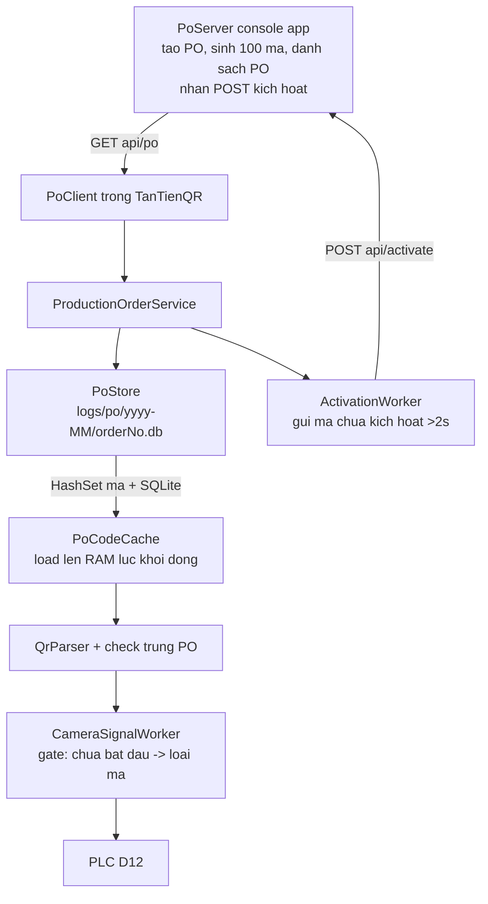

## Quyết định thiết kế đã chọn

Do bảng hỏi bị hủy, tôi chọn các phương án phù hợp nhất với codebase hiện tại. Bạn có thể yêu cầu điều chỉnh:

| Quyết định     | Chọn                                          | Lý do                                                                      |
| -------------- | --------------------------------------------- | -------------------------------------------------------------------------- |
| Server giả lập | Console app riêng `tools/PoServer`            | Chạy độc lập, không lẫn vào SCADA; tái dùng pattern `tools/LicenseTool`    |
| Định dạng mã   | TXNG Digital Link `/01/{gtin}/21/{serial}`    | Khớp `QrParser` hiện tại → camera đọc được thật                            |
| DB PO          | File riêng `logs/po/{yyyy-MM}/{orderNo}.db`   | Check trùng chỉ trong 1 PO; `logs/scans.db` giữ nguyên làm lịch sử tra cứu |
| Gửi kích hoạt  | Worker nền tự động mỗi >2s + nút gửi thủ công | Đúng yêu cầu "chu kỳ tuỳ chọn >2s/lần"                                     |

## Kiến trúc

## 1. Project mới: `tools/PoServer` (console app)

- `PoServer.csproj` — net10.0, `Microsoft.Data.Sqlite`, tham chiếu `ClassLibraryMT.Scans` (dùng `QrParser` logic tương đương; nếu `QrParser` internal thì copy regex sang project tool)
- `Program.cs` — `HttpListener` trên `http://127.0.0.1:5080/`
  - `GET /api/po` → danh sách PO còn hiệu lực (chưa bị SCADA lấy) kèm `orderNo`, `orderQty`, `createdUtc`
  - `GET /api/po/{orderNo}/codes` → tải tập mã của PO
  - `POST /api/activate` → nhận mã kích hoạt, đánh dấu đã kích hoạt
  - `POST /api/po` → tạo PO mới (`orderNo`, `orderQty`), server tự sinh `orderQty` mã mẫu
- `PoServerStore.cs` — SQLite `logs/po-server.db`: bảng `Orders` (`OrderNo`, `OrderQty`, `CreatedUtc`, `IssuedUtc`, `CompletedUtc`, `Status`), bảng `Codes` (`OrderNo`, `Code`, `Gtin`, `Serial`, `ActivatedUtc`)
- Seed mặc định 3 PO × 100 mã, GTIN `08934567890123`, serial `PO{orderNo}{i:D6}`

## 2. Library mới: `ClassLibraryMT.Po` (dùng chung SCADA + tool)

- `ProductionOrder.cs` — model: `OrderNo`, `OrderQty`, `CreatedUtc`, `Additional` (dictionary mở rộng sau này)
- `ProductionOrderStatus.cs` — enum: `Available`, `Downloaded`, `Running`, `Completed`, `Closed`
- `PoOptions.cs` — cấu hình `appsettings.json` section `Po`: `BaseUrl`, `DbRoot` (`logs/po`), `ActivationIntervalMs` (mặc định 2500), `AutoActivate` (true), `CodeSampleSize` (100)
- `PoClient.cs` — `HttpClient` gọi server: `GetOrdersAsync`, `GetCodesAsync`, `ActivateAsync` (tương thích AOT: dùng `JsonSerializerContext` source-generated, theo pattern `CheckeeJsonContext`)
- `PoStore.cs` — quản lý file DB theo PO:
  - Đường dẫn: `{DbRoot}/{yyyy-MM}/{OrderNo}.db`
  - Bảng `PoCodes` (`Code` PK, `Gtin`, `Serial`, `ScannedUtc`, `Status`), bảng `PoMeta` (`Key`, `Value`) lưu trạng thái PO
  - `EnsurePoDbAsync(orderNo, codes)` — tạo file + insert tập mã lần đầu
  - `GetScannedCodesAsync(orderNo)` — đọc mã đã quét (dùng khi khởi động app để rebuild RAM cache)
- `PoCodeCache.cs` — cache RAM: `Dictionary<string, HashSet<string>>` theo OrderNo (mã đã quét trong PO) + `HashSet<string>` mã hợp lệ của PO đang chạy. Load lên lúc khởi động từ các file DB PO.
- `ProductionOrderService.cs` — điều phối:
  - `CurrentOrder` (PO đang chạy), `CurrentStatus`
  - `StartProductionAsync(orderNo)` → set `Running`, khóa PO, nạp mã hợp lệ vào RAM
  - `CompleteProductionAsync()` → set `Completed`, ghi vào DB gốc, giải phóng khóa
  - `DownloadOrdersAsync()` → tải PO từ server, tạo DB riêng cho PO mới
  - `TryValidateCodeAsync(gtin, serial)` → false nếu chưa bắt đầu / PO không khớp / mã trùng trong PO
- `PoServiceCollectionExtensions.cs` — `AddProductionOrders(configuration)` đăng ký DI (AOT-safe bind thủ công)

## 3. Tích hợp camera: gate PO vào `CameraSignalWorker`

- `TanTienQR/Services/CameraSignalWorker.cs`: thêm `ProductionOrderService _po` vào constructor
- Trong `HandleAsync`, sau bước `QrParser.TryParse` và **trước** `IsDuplicate`:
  - Nếu `!_po.IsProductionRunning` → `Publish(..., ScanOutcome.NoProductionOrder, ...)` và **không** ghi PLC (loại hết mã)
  - Nếu mã không thuộc tập hợp lệ của PO đang chạy → `ScanOutcome.InvalidForOrder`
  - Nếu mã đã quét trong PO này → `ScanOutcome.Duplicate` (check trong RAM cache, O(1))
- `TanTienQR/Models/TanTienEnums.cs`: thêm `NoProductionOrder`, `InvalidForOrder` vào `ScanOutcome`

## 4. Bảng "Thông tin sản xuất" trong tab Sự kiện gần đây

- `TanTienQR/Views/InfoView.axaml`: cột phải (`Grid.Column="1"`, width 330) hiện là panel "SỰ KIỆN GẦN ĐÂY" → thay bằng `TabControl` 2 tab: **Sự kiện gần đây** | **Thông tin sản xuất**
- Panel "Thông tin sản xuất" hiển thị: OrderNo, số lượng đơn (`orderQty`), số mã đã quét / tổng, trạng thái (Chưa bắt đầu / Đang chạy / Hoàn tất), thời điểm bắt đầu, thời điểm hoàn tất
- `TanTienQR/ViewModels/MainViewModel.Scans.cs`: thêm `ProductionInfo` (ViewModel con) + cập nhật trong `AddEvent`/`AddScan`
- `TanTienQR/ViewModels/ProductionInfoViewModel.cs`: binding thuộc tính hiển thị + `NotifyPropertyChanged` khi PO đổi trạng thái

## 5. Tab "Truy xuất Sản xuất (Local)"

- `TanTienQR/Models/AppSection.cs`: thêm `ProductionOrders = 8`
- `TanTienQR/ViewModels/MainViewModel.Tabs.cs`: thêm `IsProductionOrdersVisible`, `ShowProductionOrdersTabCommand`, `PageTitle`/`PageSubtitle`, cờ quyền
- `TanTienQR/ViewModels/ProductionOrdersViewModel.cs` — ViewModel tab:
  - Danh sách PO đã tải về từ server: OrderNo, orderQty, số đã quét, trạng thái, thời điểm
  - Nút **Tải PO từ server** (gọi `DownloadOrdersAsync`)
  - Nút **Bắt đầu sản xuất** / **Hoàn tất sản xuất**
  - Dropdown chọn PO — khoá khi đang chạy
- `TanTienQR/Views/ProductionOrdersView.axaml` — view tab mới (bảng PO + panel điều khiển + nút tải/cập nhật)
- `TanTienQR/Views/MainWindow.axaml`: thêm nút tab trên header + chip sidebar + `<views:ProductionOrdersView>` trong vùng nội dung
- Phân quyền: dùng `Permission.ViewProduction` (Worker+ đều xem được); nút bắt đầu/hoàn tất dùng `Permission.EditConfig` (Operator+) — không thêm quyền mới vào `ClassLibraryMT.Auth` để không ảnh hưởng app khác trong repo

## 6. Worker gửi mã kích hoạt định kỳ

- `TanTienQR/Services/PoActivationWorker.cs` — `BackgroundService`:
  - Vòng lặp chờ `ActivationIntervalMs` (>2s, mặc định 2500ms)
  - Nếu đang có PO `Running` → lấy tất cả mã **chưa kích hoạt** của PO (đọc từ RAM cache + DB PO), `POST /api/activate`
  - Đánh dấu đã kích hoạt trong DB PO sau khi server nhận OK
  - Nút gửi thủ công trong tab gọi cùng một hàm `ActivatePendingAsync()`
- Đăng ký trong `TanTienAppServices.AddTanTienServices`

## 7. Cấu hình & tài liệu

- `TanTienQR/appsettings.json`: thêm section `Po` (`BaseUrl`, `DbRoot`, `ActivationIntervalMs`, `AutoActivate`, `CodeSampleSize`)
- `TanTienQR/Services/TanTienAppServices.cs`: đăng ký `AddProductionOrders(configuration)` + `PoActivationWorker`
- `VisionF.slnx`: thêm `tools/PoServer/PoServer.csproj`
- `docs/plc-settings.md` hoặc file mới `docs/production-order.md` — mô tả luồng PO, cấu trúc DB, cách chạy server giả lập

## 8. Kiểm thử

- `dotnet build` toàn solution
- Chạy `PoServer`, seed PO; chạy SCADA → tải PO → xác nhận tạo `logs/po/{yyyy-MM}/{orderNo}.db`
- Quét mã trước khi bắt đầu → phải bị loại (không ghi PLC)
- Bắt đầu sản xuất → quét mã hợp lệ → Pass, ghi D12; quét lại cùng mã → Duplicate
- Hoàn tất sản xuất → mở khoá chọn PO; PO đã hoàn tất không hiện trong danh sách chạy
- Kiểm tra worker kích hoạt: server nhận mã định kỳ >2s/lần

## Điểm cần bạn xác nhận khi triển khai

1. Server giả lập ở `tools/PoServer` (console) — đồng ý? Đồng ý
2. Mã mẫu theo TXNG Digital Link `/01/08934567890123/21/{serial}` — đồng ý? Đồng ý
3. DB PO tách file `logs/po/{yyyy-MM}/{orderNo}.db`, `logs/scans.db` giữ nguyên — đồng ý? Đồng ý
4. Worker tự động gửi kích hoạt mỗi 2500ms + có nút gửi thủ công — đồng ý? Đồng ý

