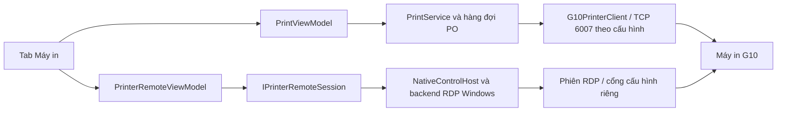

# Kế hoạch làm lại tab Máy in: điều khiển từ xa trong khung 16:9

Ngày lập: 25/11/2026. Trạng thái: đã triển khai bản cục bộ trên Windows; chưa nghiệm thu với máy G10 thật. Người dùng xác nhận hiện chưa có thiết bị để thử.

## 1. Kết quả cần đạt

Tab **Máy in** hiển thị trực tiếp giao diện thật của máy G10 để người vận hành xem, chạm/bấm và nhập liệu ngay trong TanTienApp. Vùng màn hình máy in luôn có tỷ lệ **16:9**; thanh công cụ và thông tin PO nằm ngoài vùng này.

Màn hình remote là nội dung chính. Thông tin PO, gửi mã, mực, buffer và trạng thái in được bố trí gọn bên cạnh. Có chế độ **Phóng to** ngay trong tab để dành phần lớn diện tích cho máy in.

Giả định triển khai đợt đầu: nhúng RDP trên Windows, phù hợp với mã tham chiếu trong `Print`. Bản Linux tiếp tục build và chạy phần in TCP; backend remote Linux là công việc tiếp theo nếu cần. Đây là phạm vi đề xuất, chưa phải khả năng đã được kiểm chứng trên thiết bị.

## 2. Căn cứ từ thư mục Print và app hiện tại

| Nguồn | Điều đã xác định | Ảnh hưởng tới thiết kế |
|---|---|---|
| `Print/ucG10Monitor.cs:47` | Dùng ActiveX `AxMsRdpClient9NotSafeForScripting`, không dùng VNC hay trang HTTP | Chọn hướng RDP; không coi `NativeWebView` là client RDP |
| `Print/ucG10Monitor.cs:63` | Server lấy IP máy in, tài khoản legacy là `odroid` | Cấu hình remote riêng, mặc định host theo máy in đang chọn; xác minh lại tài khoản thực tế |
| `Print/ucG10Monitor.cs:66` | Desktop 1920×1080, SmartSizing, control 960×540 | Yêu cầu remote desktop 1920×1080 và giữ khung 16:9 khi đổi kích thước |
| `Print/G10Monitor.cs:19`, `Print/ucG10Printer.cs:1185` | Legacy mở monitor bằng Form riêng | Thay bằng surface nhúng trong tab hiện tại |
| `Print/command/CommandString.cs:11` | Có START/STOP/CLR/RESET/CLENOZ/JET và truy vấn trạng thái | Giữ các lệnh hiện có, tiếp tục gửi qua client TCP |
| `Print/ucG10Printer.cs:557` | GFILE chứa `CU:<id>` và danh sách `<id>:<name>` | Đọc bản tin đang dùng để đồng bộ khi đổi trên remote |
| `TanTienQR/TanTienQR.csproj:5` | Avalonia, .NET 10, `PublishAot=true`; dự án có bản Windows/Linux | Tách phần Windows/COM khỏi app AOT; không chuyển toàn bộ app sang WinForms |
| `TanTienQR/Views/PrintView.axaml:59` | Trang hiện tại ưu tiên các card trạng thái và gửi lệnh; chưa có remote | Viết lại bố cục, tái sử dụng nghiệp vụ |
| `TanTienQR/Views/LazyTabHost.cs:7` | View tạo khi mở tab lần đầu rồi được giữ lại | Cần vòng đời remote theo trạng thái hiển thị/đăng nhập, không chỉ attach/detach |
| `ClassLibraryMT.Print/PrintService.cs:104` | Gửi mã PO có trạng thái chống lấy lại mã đã gửi/in | Kết nối remote độc lập với luồng dữ liệu PO |

Mã legacy có thông tin đăng nhập ghi trực tiếp trong source. Bản mới dùng thông tin cấu hình và kho thông tin xác thực của Windows; không sao chép mật khẩu vào code, tài liệu, log hoặc tham số tiến trình.

Đọc mã nguồn chỉ xác nhận cách legacy được viết. Cổng RDP, cơ chế xác thực và việc phiên RDP có hiển thị đúng HMI đang chạy trên màn hình vật lý vẫn cần thử trên máy thật.

## 3. Bố cục giao diện

### Khi đủ diện tích

- **Hàng đầu:** tên máy, trạng thái kết nối TCP và trạng thái remote, hiển thị riêng biệt.
- **Cột chính:** thanh công cụ remote gồm Kết nối/Kết nối lại, Ngắt và Phóng to; bên dưới là màn hình máy in 16:9, căn giữa.
- **Cột thao tác khoảng 300–320 DIP:** PO đang chạy; số lượng và nút Gửi mã; trạng thái in, mực hai đầu, buffer và bản tin hiện tại; nút Bật in/Tạm dừng luôn dễ thấy. Có thể thêm số đếm thiết bị sau khi kiểm chứng CSTATUS.
- **Nhóm mở rộng trong cột thao tác:** bảo trì và lịch sử lệnh có vùng cuộn riêng. Các phản hồi thao tác nằm gần nút liên quan.

### Khi cửa sổ nhỏ hoặc mở bàn phím ảo

MainWindow hiện có sidebar rộng 232 DIP, kích thước tối thiểu 1100×700 và bàn phím ảo chiếm một hàng riêng. Bố cục phải dựa trên diện tích thực còn lại của tab, không chỉ độ phân giải màn hình.

- Chuyển sang màn hình remote ở trên, phần thao tác có vùng cuộn ở dưới khi cột bên khiến màn hình quá nhỏ. Mốc khởi đầu để thử bố cục: nội dung tab rộng dưới khoảng 1000 DIP; hiệu chỉnh bằng kiểm tra giao diện.
- Chế độ Phóng to thu gọn phần thao tác, giữ thanh công cụ remote và tỷ lệ 16:9 ngay trong TanTienApp.
- Không đặt toàn bộ surface native trong một ScrollViewer và trông chờ clipping của Avalonia. Ưu tiên bố cục hữu hạn; chỉ phần card thông tin/lịch sử cuộn.

### Quy tắc bắt buộc của vùng màn hình

Sau khi trừ toolbar, padding và vùng thao tác, gọi diện tích khả dụng là `W × H`:

```text
screenWidth  = min(W, H × 16 / 9)
screenHeight = screenWidth × 9 / 16
```

- Dùng panel/control đo và sắp xếp kích thước thật, căn giữa. Không cố định Height=540 và không dùng Viewbox để scale một HWND.
- Surface native được resize theo bounds thực; toolbar và viền card không tính vào tỷ lệ màn hình.
- Yêu cầu desktop 1920×1080. Nếu server trả tỷ lệ khác, hiển thị trọn nội dung và thêm dải nền trống; không kéo méo hoặc cắt hình.
- Với backend native, ưu tiên để client RDP xử lý input theo SmartSizing; chỉ tự quy đổi tọa độ nếu backend yêu cầu. Khi đó phải trừ dải nền trống và tính DPI để tránh scale hai lần.
- Sai số làm tròn kích thước ở mức tối đa một pixel vật lý. Cả trạng thái đang tải/lỗi/chưa kết nối cũng dùng cùng khung 16:9.

## 4. Kiến trúc remote đề xuất

Hai luồng kết nối cùng trỏ về máy in nhưng có vòng đời riêng:



### Hướng ưu tiên để thử nghiệm

Tạo backend Windows riêng: một helper WinForms **không AOT** chứa ActiveX RDP, còn app Avalonia tiếp tục Native AOT. `NativeControlHost` chứa một HWND do app quản lý; helper tạo surface con trong vùng host. Trao đổi lệnh và sự kiện bằng named pipe có kiểm soát phiên. Helper dự kiến target `net10.0-windows`, x64, `UseWindowsForms=true`, tắt trimming/AOT và đóng gói self-contained; chỉ đưa vào gói Windows.

Căn cứ kỹ thuật: Microsoft nêu giới hạn COM tích hợp của [Native AOT trên Windows](https://learn.microsoft.com/en-us/dotnet/core/deploying/native-aot/). Avalonia hỗ trợ nhúng HWND qua [NativeControlHost](https://docs.avaloniaui.net/docs/app-development/native-interop), đồng thời nêu giới hạn transform, clipping và thứ tự hiển thị của surface native.

Hướng này tận dụng client RDP legacy nhưng phải chứng minh được việc nhúng HWND khác tiến trình trên cấu hình Windows đích. Không coi `SetParent` đơn thuần là giải pháp hoàn chỉnh. Cần kiểm chứng DPI, focus, thông điệp cửa sổ và đóng/mở host trước khi chốt backend. Microsoft mô tả tác động của khác biệt DPI awareness giữa hai tiến trình trong [SetParent](https://learn.microsoft.com/en-us/windows/win32/api/winuser/nf-winuser-setparent). Chức năng co nội dung theo vùng client của RDP được mô tả tại [SmartSizing](https://learn.microsoft.com/en-us/windows/win32/termserv/imsrdpclientadvancedsettings-smartsizing).

Nếu cách nhúng helper không đạt, thử bridge native Windows chạy cùng tiến trình, cung cấp C ABI cho app AOT và chứa COM RDP ở phía native. Đánh giá thêm công cụ build và khả năng xử lý lỗi của bridge. Dù chọn cách nào, tiêu chí sản phẩm vẫn là điều khiển ngay trong tab; mở `mstsc.exe` thành cửa sổ riêng không hoàn thành yêu cầu này.

Không tắt AOT cho app chính để né vấn đề COM. Không cài thêm gateway web/VNC khi chưa có bằng chứng thiết bị hỗ trợ hoặc nhu cầu vận hành tương ứng.

### Hợp đồng và trạng thái

- `IPrinterRemoteSession`: kiểm tra khả năng hỗ trợ nền tảng; kết nối/ngắt; cập nhật trạng thái; gắn/tháo surface và kích thước; hủy tác vụ, dọn tài nguyên.
- `PrinterRemoteViewModel`: trạng thái `Disabled`, `Unsupported`, `Disconnected`, `Connecting`, `Connected`, `Reconnecting`, `Faulted`; thông báo tiếng Việt và lệnh toolbar.
- Phân biệt lỗi xác thực, host không truy cập được, timeout, chứng thư và lỗi tạo backend. Chỉ tự thử lại lỗi mạng tạm thời với khoảng chờ tăng dần; lỗi xác thực dừng để chỉnh cấu hình.
- `Remote.IsConnected` độc lập với trạng thái TCP. RDP lỗi vẫn xem/gửi mã qua TCP nếu đủ điều kiện; TCP lỗi vẫn có thể điều khiển HMI qua RDP.
- Các nút native như START/STOP tiếp tục qua `PrintService`. Trạng thái trên app lấy từ polling máy in, không suy ra từ việc bấm nút trong remote.

### Vòng đời và input

- Chỉ tạo backend khi mở tab lần đầu và đáp ứng điều kiện license/module/remote. Có thể tự kết nối khi mở tab nếu đã cấu hình đủ.
- Khi chuyển tab: ẩn HWND, nhả focus và khóa input remote; có thể giữ phiên để quay lại nhanh. Không tạo thêm helper/phiên mỗi lần chuyển tab.
- Khi đăng xuất, khóa giao diện bằng overlay đăng nhập, mất entitlement hoặc đóng app: ẩn surface ngay, hủy reconnect, ngắt và dọn phiên. Cần hook sự kiện đăng nhập/license bên cạnh `IsPrintVisible`.
- Native surface có thể nằm trên lớp render Avalonia. Toolbar nằm ngoài HWND; ẩn surface trước các overlay/hộp thoại chồng lên nó, phục hồi đúng bounds/focus khi đóng.
- Xử lý click, kéo, cuộn, phím thường, phím chức năng, Tab và tổ hợp phím khi khung có focus; giữ thao tác chuyển tab/thoát chế độ phóng to khả dụng ở app.
- Kiểm tra chuyển focus giữa remote và ô số lượng, F11/Esc của cửa sổ chính và luồng quét mã khi remote giữ focus; không để thao tác nhập ở HMI kích hoạt nhầm lệnh app.
- Thử riêng touch và bàn phím ảo. Bàn phím ảo hiện phục vụ ô nhập Avalonia, nên không mặc định gõ được vào HMI. Nếu cần nhập chạm, bổ sung tuyến gửi phím/text vào remote và kiểm chứng Unicode trên thiết bị.
- Helper chỉ nhận thông tin xác thực qua IPC sau khi khởi chạy; không ghi secret vào command line. Theo dõi tiến trình cha và dọn khi app chết để không còn cửa sổ/phiên mồ côi.

## 5. Cấu hình

Đề xuất thêm nhóm `Print:Remote`, tách khỏi cổng TCP G10:

| Khóa | Mặc định đề xuất / ý nghĩa |
|---|---|
| `Enabled` | `false` khi nâng cấp cấu hình cũ; bật sau khi điền thông tin remote |
| `Host` | Trống = IP máy in mặc định đã được chọn theo `DefaultPrinterId` |
| `Port` | `3389`, giá trị gợi ý RDP; phải xác minh trên máy thật |
| `Username` | Người cấu hình nhập, không gán cứng tài khoản legacy |
| `CredentialTarget` | Tham chiếu thông tin đăng nhập được lưu trong Windows Credential Manager |
| `AutoConnect` | `true` khi mở tab và đủ điều kiện |
| `ConnectTimeoutSeconds` | `15`; xử lý timeout riêng của remote |

Tỷ lệ màn hình cố định 16:9 trong control; desktop yêu cầu 1920×1080 trong backend, không cần đưa thành thông số vận hành ở đợt đầu. Các tùy chọn remote được nạp lúc khởi động cùng cơ chế options hiện có. Metadata form đánh dấu `RequiresRestart=true` và dùng banner khởi động lại khi lưu thay đổi. Khi Host trống, lấy IP từ đúng máy in/options đang có hiệu lực, tránh ghép cấu hình TCP cũ với IP mới chỉ vừa lưu. Secret được tra cứu từ kho credential mỗi lần kết nối, không giữ bản sao trong snapshot JSON.

Điều kiện cho phép remote là đã đăng nhập, license có entitlement `printer`, module Print bật, Remote bật và nền tảng hỗ trợ. Không yêu cầu TCP đã kết nối mới cho phép RDP. Dùng quyền truy cập tab hiện có; không tự tạo ma trận vai trò mới.

Thêm model cấu hình và metadata form, normalize/validation, source-generated JSON context, mapping DI và kiểm thử lưu/đọc. Lưu secret qua dịch vụ credential riêng, không qua `ConfigStore`. Cấu hình cũ thiếu `Remote` phải tiếp tục đọc được và giữ nguyên các khóa lạ.

## 6. Đồng bộ chức năng máy in khi làm lại trang

1. Giữ gửi mã theo PO và lượng người dùng nhập, cùng các trạng thái `Pending → Sent → Printed/NoResponse`. Tiếp tục ghi `Sent` trước khi truyền và nhận `BACK` bằng worker hiện có.
2. Giữ các nút đang dùng: START/STOP, CLR, RESET|1, CLENOZ, JET và đọc bản tin. Chuyển nhóm bảo trì sang vùng gọn để ưu tiên diện tích remote.
3. Tách cách đọc phản hồi truy vấn GFILE khỏi cách kiểm tra ACK. Hiện `PrintService.RefreshFilesAsync()` kiểm tra `GFILE|OK`, trong khi legacy xử lý phản hồi dạng `GFILE|CU:13,13:Carton`; đồng thời sửa đánh dấu thành công trong lịch sử client.
4. Parse GFILE thành danh sách và bản tin hiện tại, đưa `Job` thực vào snapshot. Đọc lại định kỳ với tần suất thấp hơn trạng thái nhanh để nhận thay đổi từ remote, tránh tăng tải TCP không cần thiết.
5. Phần mở rộng tùy chọn: bổ sung số đếm thiết bị qua CSTATUS sau khi xác nhận định dạng. Phân biệt số đếm máy với số mã PO đã được xác nhận; không dùng reset số đếm để thay đổi state PO. CSTATUS chưa kiểm chứng không chặn nghiệm thu remote/16:9.
6. Bản đầu dùng remote để chỉnh/chọn bản tin. Chưa cần thêm một form SFILE trùng với giao diện máy in; có thể bổ sung sau khi có nhu cầu cụ thể.

Không chuyển luồng sinh prefix/index của `StartWith` vào PO. Không tự chạy chuỗi STOP/CLR/RESET/START của legacy khi mở remote, kết nối lại hoặc gửi lô. Các thao tác người dùng thực hiện trực tiếp trên HMI không tự biến thành sự kiện cập nhật state PO; app chỉ ghi nhận bằng phản hồi giao thức được hỗ trợ.

## 7. Trình tự triển khai

### Bước 1 — Kiểm chứng RDP và lớp nhúng

Tạo thử nghiệm tối thiểu, tách khỏi luồng PO. Kiểm tra trên máy G10 thật hoặc môi trường thử tương đương:

- RDP vào đúng giao diện HMI đang vận hành; đối chiếu với màn hình vật lý để phát hiện phiên desktop mới hoặc việc chiếm/ngắt phiên hiện tại.
- Host/cổng/tài khoản/xác thực/chứng thư; khả năng chạy song song RDP và TCP.
- Nhúng native trong app AOT: 16:9, SmartSizing, resize, DPI nhiều màn hình, focus, touch/phím, input từ bàn phím ảo, ẩn surface khi đăng nhập/overlay.
- Ngắt/kết nối lại, lỗi helper, thoát app và không còn tiến trình/phiên mồ côi.
- Ước lượng dung lượng gói helper/runtime và cách đóng gói trong updater hiện có.

**Đầu ra:** quyết định backend có bằng chứng, ảnh/video thử nghiệm và danh sách giới hạn thực tế. Nếu RDP không hiển thị đúng HMI, cần tìm cơ chế chia sẻ phiên phù hợp với firmware trước khi code toàn bộ trang.

### Bước 2 — Cấu hình và quản lý phiên

Thêm abstraction remote, adapter Windows, backend Unsupported cho nền tảng khác, credential service và sub-ViewModel. Hook vòng đời tab/đăng nhập/license/đóng app. Giữ toàn bộ luồng TCP nền hoạt động độc lập.

**Đầu ra:** kết nối, ngắt, báo lỗi và reconnect hoạt động trong host thử nghiệm; đọc được cấu hình cũ/mới; app AOT vẫn build trên hai nền tảng.

### Bước 3 — Viết lại PrintView

Dựng control 16:9 và bố cục mới, thanh công cụ remote, cột PO/gửi mã, phóng to trong tab và các trạng thái chờ/lỗi. Kiểm tra layout với kích thước cửa sổ tối thiểu và lúc bật bàn phím ảo.

**Đầu ra:** xem và điều khiển được HMI trong tab; màn hình giữ đúng tỷ lệ ở mọi bố cục được hỗ trợ.

### Bước 4 — Đồng bộ dữ liệu và hồi quy

Sửa GFILE và cập nhật job; xác nhận thay đổi trên remote được phản ánh về app. Kiểm tra gửi mã, buffer, phản hồi BACK, đối soát và mất kết nối. Chỉ thêm số đếm CSTATUS nếu đã kiểm chứng được phản hồi của firmware.

**Đầu ra:** thay đổi UI/remote không tạo gửi trùng, không tự thay đổi state PO hoặc làm dừng worker TCP.

### Bước 5 — Đóng gói và nghiệm thu

Build/publish AOT Windows/Linux; đưa helper/bridge và phụ thuộc vào gói Windows; thử máy Windows sạch, cập nhật và rollback tại môi trường thử. Cập nhật `docs/printing.md` với thao tác remote và giới hạn nền tảng.

Lưu ý cụ thể: `deploy/update/UpdateRelease.psm1` hiện chỉ lấy `TanTienQR.exe` và DLL ở thư mục gốc cho gói Windows, đồng thời từ chối thư mục con. Nếu dùng helper EXE/runtime đi kèm, phải sửa allowlist, manifest, build script và kiểm thử phục hồi; không chỉ copy helper vào thư mục publish rồi cho rằng updater sẽ mang theo.

**Đầu ra:** gói cài đặt đủ thành phần, mở được remote mà không cần bộ phát triển; bản Linux hiển thị trạng thái chưa hỗ trợ remote nhưng chức năng TCP vẫn dùng được.

## 8. Các tệp dự kiến thay đổi

| Nhóm | Tệp / công việc |
|---|---|
| Giao diện | `TanTienQR/Views/PrintView.axaml`, `.axaml.cs`; control `PrinterRemoteHost` và panel giữ 16:9 mới |
| ViewModel | `TanTienQR/ViewModels/PrintViewModel.cs`; `PrinterRemoteViewModel.cs` mới |
| Remote | Hợp đồng/session/backend/credential trong nhóm `TanTienQR/Services/PrinterRemote/` mới; helper hoặc bridge Windows theo kết quả Bước 1 |
| Vòng đời | `TanTienQR/ViewModels/MainViewModel.Tabs.cs`, luồng đăng nhập/license/đóng cửa sổ có liên quan; giữ cơ chế lazy hiện có |
| Cấu hình | `AppConfigModels.cs`, `ConfigStore.cs`, validation/schema, options remote và `appsettings.json`; mapping tại `TanTienAppServices.cs` |
| Giao thức | `ClassLibraryMT.Print/G10PrinterClient.cs`, `PrintModels.cs`, `PrintService.cs`; `PrinterMonitorService.cs` để đưa job lên UI, số đếm là mở rộng tùy chọn |
| Đóng gói | Project helper/bridge mới, `TanTienQR.csproj` nếu cần; `deploy/update/build-release.ps1`, `UpdateRelease.psm1` và kiểm thử release |
| Kiểm thử/tài liệu | `tools/PrintTests`, kiểm thử cấu hình/UI/remote có liên quan, `docs/printing.md` |

## 9. Tiêu chí nghiệm thu

- [ ] HMI thật điều khiển được bằng chuột/touch và bàn phím ngay trong tab Máy in; xác minh đúng phiên HMI cần vận hành.
- [ ] Vùng màn hình giữ 16:9 ở 1100×700, 1360×820, FullScreen và các DPI 100/125/150/200%; không méo/cắt ảnh hoặc lệch click.
- [ ] Bật bàn phím ảo và phóng to vẫn giữ đúng tỷ lệ; nhập liệu vào remote hoạt động theo cơ chế đã kiểm chứng.
- [ ] Chuyển tab nhiều lần không nhân đôi phiên; remote không che overlay đăng nhập hoặc nhận input khi bị ẩn.
- [ ] Sai mật khẩu, host không tồn tại, timeout, đứt mạng, helper lỗi đều có trạng thái đúng; không reconnect vô hạn khi lỗi xác thực.
- [ ] TCP và RDP hiển thị hai trạng thái độc lập; lỗi một luồng không tự ngắt luồng còn lại.
- [ ] Thay đổi trạng thái in/job từ remote được cập nhật về app; GFILE dữ liệu hợp lệ không báo lỗi ACK giả.
- [ ] Gửi mã và nhận BACK vẫn đúng state; đóng/mở remote không tự gửi lại mã hoặc thực hiện START/STOP/CLR/RESET.
- [ ] Đăng xuất/mất license/thoát app dọn được surface, phiên và helper; không lộ thông tin xác thực trong cấu hình/log/command line.
- [ ] Gói Windows chứa đủ thành phần remote và qua thử cập nhật/rollback; bản Linux build và phần in TCP vẫn chạy.

Các kiểm tra tự động triển khai cùng thay đổi: hồi quy `dotnet run --project tools/PrintTests -c Debug`; thêm ca GFILE/current job, CSTATUS nếu triển khai; kiểm tra tính tỷ lệ/DPI, vòng đời bằng backend giả và cấu hình cũ/mới. Build `dotnet build TanTienQR/TanTienQR.csproj -c Debug` và publish AOT theo quy trình phát hành hiện tại. Kiểm thử headless chỉ xác minh bố cục/trạng thái, không thay thế thử RDP native và input trên Windows thật.

## 10. Những điều chưa xác minh

Chưa kết nối tới máy in thật. Chưa xác nhận RDP chia sẻ đúng HMI, cổng dịch vụ, tài khoản hiện hành, chứng thư, hỗ trợ nhập liệu Unicode và hành vi firmware khi dùng RDP song song TCP. Cơ chế nhúng ActiveX khác tiến trình đã được kiểm chứng cục bộ theo mục 11; kết quả này không thay thế thử nghiệm với firmware G10.

## 11. Kết quả triển khai cục bộ

Đã chọn và triển khai helper WinForms RDP riêng, nhúng HWND vào Avalonia, giữ app chính Native AOT. Thử nghiệm Windows thật đã xác nhận tạo ActiveX, COM settings/events, HWND khác tiến trình qua named pipe, resize/letterbox, ẩn surface khi overlay và dọn tiến trình; bài thử mạng chỉ dùng loopback.

Đã làm lại PrintView với màn hình 16:9, responsive, phóng to trong tab, cột PO/gửi mã và nút Bật/Tạm dừng cố định. Đã thêm cấu hình Remote, Windows Credential Manager, lifecycle đăng nhập/license/tab/modal, sửa GFILE và đồng bộ job. Đóng gói/update đã hỗ trợ helper theo allowlist chính xác, backup/rollback và đợi helper nhả tệp khi thoát.

Các bài thử cục bộ và hướng dẫn vận hành nằm trong `docs/printing.md`. Việc xác minh HMI trên màn hình vật lý, thao tác touch/phím/Unicode với firmware và DPI nhiều màn hình vẫn cần thiết bị thật. CSTATUS và backend remote Linux tiếp tục là phần mở rộng; chưa đưa vào bản này.
